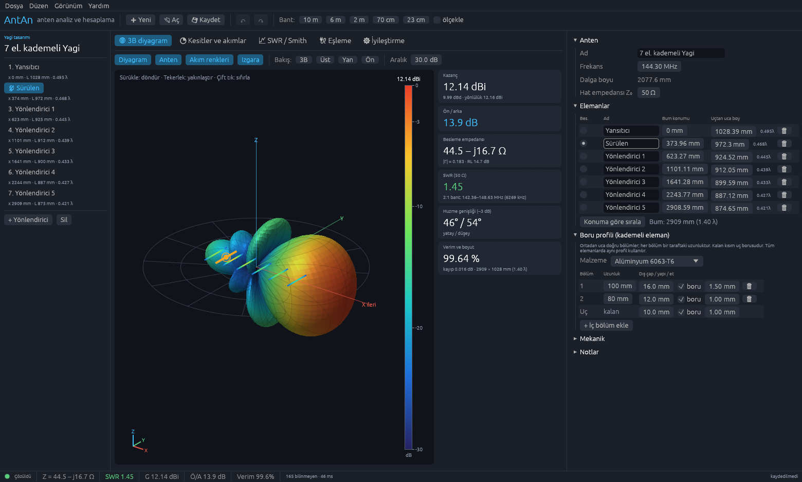
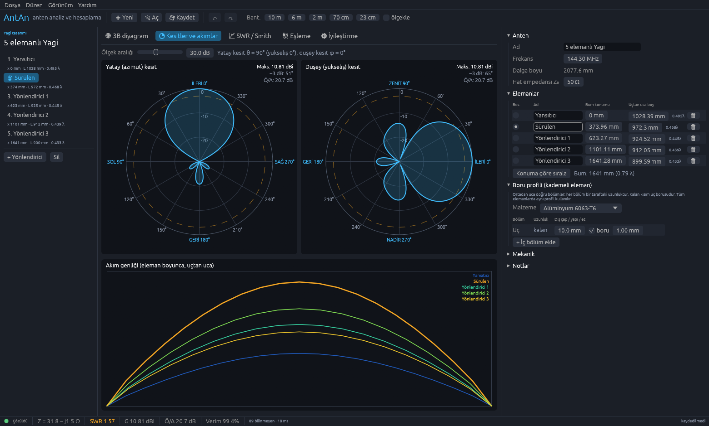
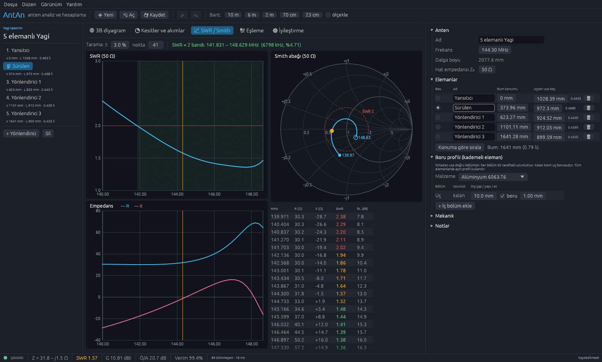
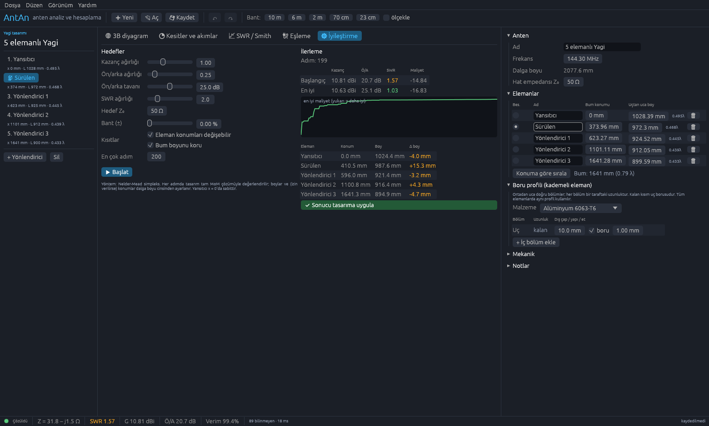
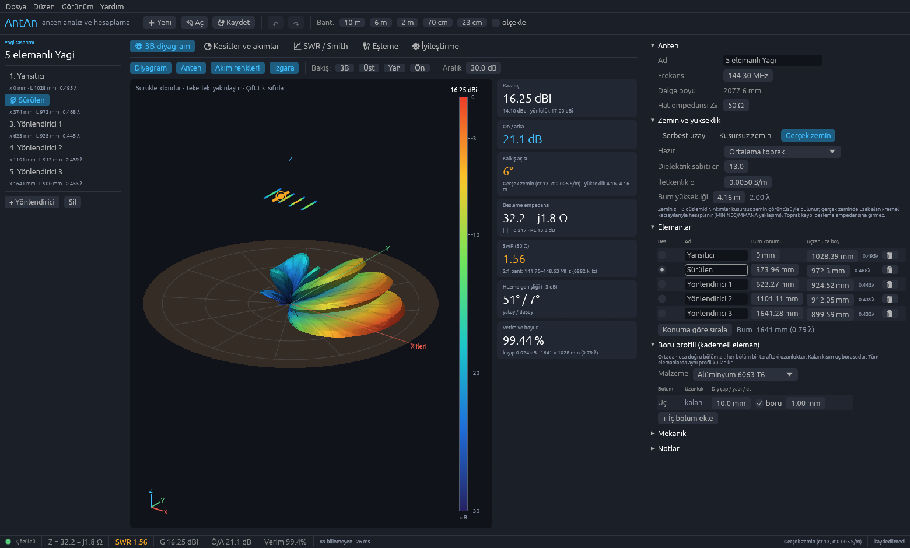

# AntAn

EZNEC/MMANA tarzı, sıfırdan Rust ile yazılmış bir **anten analiz ve hesaplama programı**.
Kendi moment yöntemi (MoM) çözücüsü, eleman bazlı Yagi tasarımı (kademeli/teleskopik borular
dahil), 3B ışıma diyagramı, Smith abağı, eşleme hesapları ve otomatik iyileştirme içerir.



| Kesitler ve akımlar | SWR, empedans ve Smith |
|---|---|
|  |  |
| **Moxon (tel modeli)** | **İyileştirme** |
|  |  |

## Özellikler

**Modeller**
- **Yagi tasarımı (eleman bazlı):** elemanlar mm cinsinden bum konumu ve uçtan uca boy ile
  düzenlenir. Ortak **boru profili**: ortadan uca kalınlaşan/incelen bölümler (ör. 16 → 12 → 10 mm),
  her bölüm için dış çap, içi dolu / boru ve et kalınlığı, malzeme seçimi.
- **Tel modeli:** her tel başlangıç/bitiş koordinatı (mm), çap, et kalınlığı, malzeme, parça sayısı.
  Teller uç uca değdiğinde otomatik **birleşim** oluşur (köşe, T, radyal yıldız).
- Şablonlar: 2–11 elemanlı Yagi, kademeli Yagi örneği, yarım dalga dipol, ters V, katlanmış dipol,
  2 elemanlı quad, delta loop, ground plane (eğik radyalli), Moxon dikdörtgeni, zemine bağlı
  çeyrek dalga dikey.
- Malzemeler: Al 6063-T6, Al 6061-T6, bakır, pirinç, paslanmaz 304, kayıpsız.

**Analiz**
- Giriş empedansı, SWR, dönüş kaybı, ışıma verimi (deri etkisi ve boru et kalınlığıyla iletken kaybı).
- Kazanç (dBi/dBd), yönlülük, ön/arka oranı, yatay/düşey −3 dB huzme genişliği.
- **3B diyagram:** aydınlatmalı, kazanca göre renklendirilmiş yüzey; ortada akım genliğine göre
  renkli anten; döndürme, yakınlaştırma, hazır bakışlar (3B/üst/yan/ön), renk ölçeği.
- Yatay ve düşey **kutupsal kesitler** (fareyle okuma), elemanlar boyunca **akım dağılımı**.
- **Frekans taraması** (arka planda, tüm çekirdeklerde paralel): SWR, R/X grafikleri,
  **Smith abağı**, 2:1 bant genişliği, değer tablosu.

**Zemin**
- Serbest uzay, **kusursuz zemin** (görüntü yöntemi) ve **gerçek zemin** (εr, σ; deniz suyu,
  ortalama toprak, kayalık vb. hazır değerler).
- Zemine değen tel uçları zemine bağlanır ve tabandan beslenebilir (monopol, dikey antenler).
- Gerçek zemin: akımlar kusursuz zeminle, uzak alan Fresnel yansıma katsayılarıyla hesaplanır
  (MININEC/MMANA yaklaşımı) → gerçekçi düşük açı kazancı ve **kalkış açısı**. Toprak kaybı
  besleme empedansına girmez.
- Yagi için bum yüksekliği (m / λ); tel modelinde tüm geometriyi kaydırma, "zemine otur".
- Zemin üzerinde azimut kesiti kalkış açısında alınır; ön/arka aynı yükseliş açısında ölçülür;
  iyileştirici kazancı kalkış açısında değerlendirir.



**Eşleme**
- L devresi (tüm çözümler, kontrol empedansıyla), hairpin (beta) boyu ve endüktansı,
  gamma çubuğu boyu ve seri kondansatörü.
- **Sürülen elemanı otomatik ayarla:** rezonansa (X = 0) veya hairpin için gereken kapasitif
  reaktansa, gerçek çözücüyle yinelenerek.

**İyileştirme (Yagi)**
- Nelder-Mead; hedefler: kazanç, ön/arka (tavanlı), SWR; isteğe bağlı bant (±%) değerlendirmesi;
  bum boyunu koruma, konumları sabit tutma seçenekleri. Arka planda çalışır, ilerleme grafiği,
  eleman bazında Δ boy tablosu; sonuç tek tıkla uygulanır (Ctrl+Z ile geri alınır).

**Mekanik**
- Eleman kütlesi, ortadan tutulan **kademeli elemanın kendi ağırlığıyla uç sarkması**
  (sayısal konsol kiriş), rüzgâr alanı ve verilen hızda rüzgâr kuvveti.

**Dosya**
- Proje: `.antan` (JSON, okunabilir). NEC-2 kart dosyası dışa aktarımı (4nec2/xnec2c/EZNEC ile
  karşılaştırma için). Pencereyi PNG kaydetme. Geri al/yinele (Ctrl+Z / Ctrl+Y), Ctrl+O / Ctrl+S.
- Bant düğmeleri (10 m … 23 cm), isteğe bağlı olarak geometriyi yeni frekansa ölçekler.

## Çalıştırma

```
cargo run --release -p antan
```

Testler (çözücü doğrulamaları dahil):

```
cargo test --workspace --release
```

## Mimari

```
crates/
  antan-core/   arayüzden bağımsız hesap motoru
    solver.rs     MoM çözücü (birleşimler, birleşimden besleme, iletken kaybı)
    farfield.rs   uzak alan, kazanç, örüntü özeti, kesitler
    yagi.rs       eleman bazlı Yagi tasarımı, kademeli profil, sürülen eleman ayarı
    templates.rs  tel modeli şablonları
    matching.rs   SWR, L devresi, hairpin, gamma
    optimize.rs   Nelder-Mead iyileştirici
    mechanics.rs  kütle, kademeli kiriş sarkması, rüzgâr
    material.rs   malzemeler, boru iç empedansı (deri etkisi)
    nec.rs        NEC-2 dışa aktarımı
    tests/        doğrulama testleri
    examples/explore.rs  şablon boyutlarını taramak için keşif aracı
  antan-app/    egui masaüstü arayüzü (koyu tema)
```

Eksenler: +X bum yönü (ileri), Y eleman ekseni, +Z yukarı. Birimler çekirdekte SI, arayüzde mm.

## Çözücü ve doğrulama

İnce tel moment yöntemi, Harrington'ın karışık potansiyelli darbe tabanlı / nokta eşlemeli
formülasyonu; indirgenmiş çekirdek, tekil kısım analitik. N telin buluştuğu noktada N−1 birleşim
tabanı kurulur (Kirchhoff kendiliğinden sağlanır). Testlerle doğrulananlar:

- İnce yarım dalga dipol ≈ 73 + j42 Ω, 2.15 dBi; parça sayısıyla yakınsama
- Kayıpsız antenlerde enerji korunumu (kazanç = yönlülük, ±0.05 dB) — birleşimli antenler dahil
- GP tabanında Kirchhoff akım yasası; birleşimden besleme = ortadan besleme
- Üç parçaya bölünmüş dipol = tek parça dipol
- Zemin: kusursuz zemin sonucu = serbest uzayda elle kurulmuş "anten + görüntü" çifti (yatay ve
  dikey, 1e-6 içinde); λ/4 monopol = dipol/2 ve +3.01 dB; λ/2 yükseklikte yatay dipolün kalkış
  açısı 30° (8.4 dBi); gerçek zeminde dikey polarizasyonun ufukta sönmesi; çok iletken gerçek
  zeminin kusursuz zemine yakınsaması
- Katlanmış dipol ≈ eşdeğer yarıçap modeli; Moxon, quad için ileri yönlülük ve yüksek Ö/A
- İletken iç empedansının DC ve deri etkisi sınırları; L devresi/hairpin çözümlerinin geri kontrolü

Şablon boyutlarının bir kısmı (quad, delta, GP, Moxon için ×1.012) bu çözücüyle taranarak
ayarlanmıştır; NEC ile birkaç yüzdelik fark normaldir.

Etkileşimsiz arayüz doğrulaması: `ANTAN_AUTOSHOT=<png yolu>` ile başlatılan program tarama
bitince pencerenin görüntüsünü kaydedip kapanır. `ANTAN_AUTOSHOT_TAB=cuts|sweep|matching|optim`,
`ANTAN_AUTOSHOT_TEMPLATE=yagi7|moxon|quad|gp|vertical|yagi_ground`, `ANTAN_AUTOSHOT_OPTIM=<adım>` ek seçeneklerdir.

## Yol haritası

- Gerçek zeminin akımlara etkisi (Sommerfeld/Norton) ve toprak kaybının empedansa yansıması
- Gömülü radyal sistemi kaybı tahmini
- Metal bum düzeltmesi (bumdan geçen / yalıtılmış elemanlar)
- Yüklemeler (bobin/kondansatör/trap), çoklu kaynak ve faz besleme, yığınlama (stacking)
- MMANA `.maa` ve NEC içe aktarma; PDF/HTML rapor
- Türkçe/İngilizce dil seçeneği
