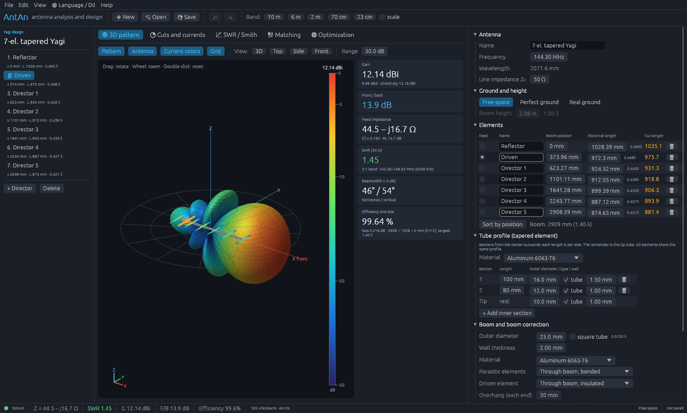
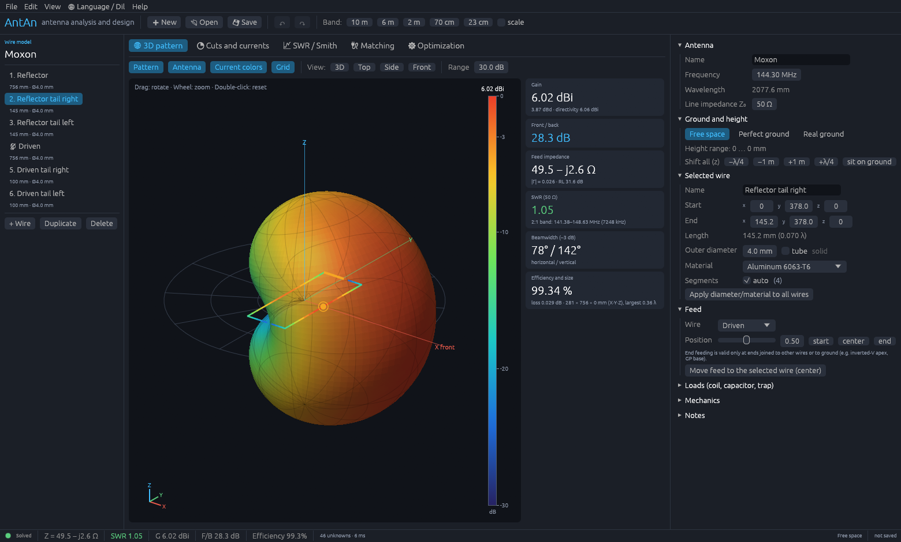
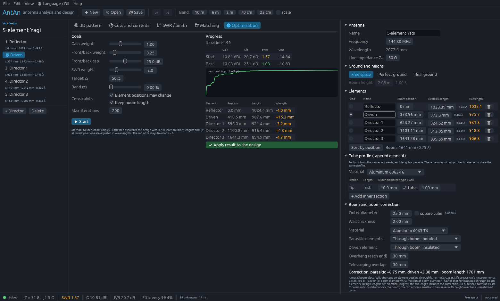
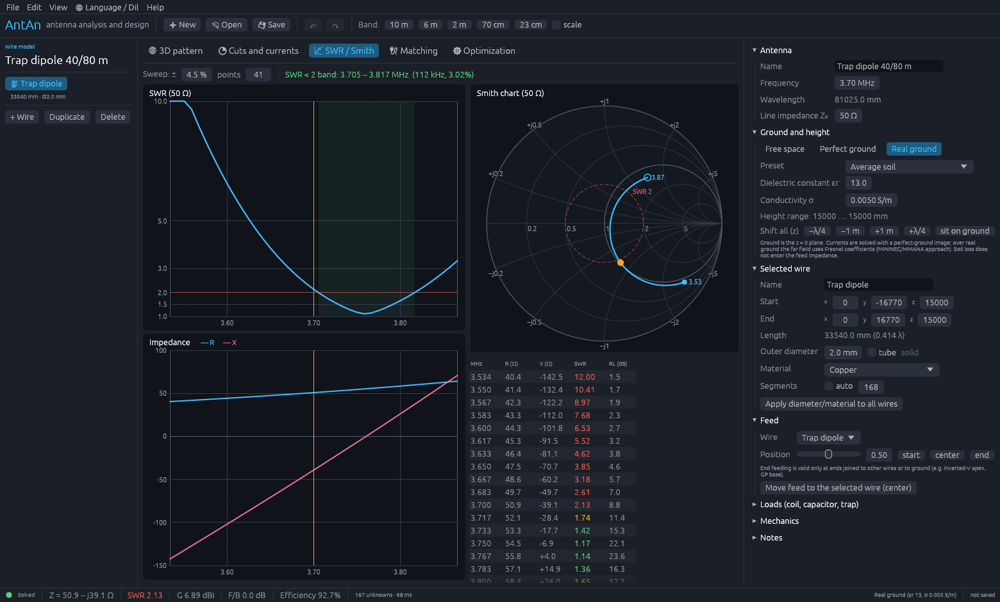

# AntAn

**English** · [Türkçe](README.tr.md)

An **antenna analysis and design program** in the spirit of EZNEC/MMANA, written from scratch in
Rust. It has its own method-of-moments (MoM) solver, element-based Yagi design (including tapered /
telescoping tubes), ground modelling, lumped loads and traps, boom correction with cut lists, a 3D
radiation pattern, a Smith chart, matching calculators and an optimizer. The user interface is
available in **English and Turkish** (Language / Dil menu).



| Cuts and currents | SWR, impedance and Smith chart |
|---|---|
|  |  |
| **Moxon (wire model)** | **Optimization** |
|  |  |

## Features

**Models**
- **Yagi design (element based):** elements are edited by boom position and tip-to-tip length in mm.
  A shared **tube profile** describes sections from the center outwards (e.g. 16 → 12 → 10 mm), each
  with outer diameter, solid rod or tube with wall thickness, and material.
- **Wire model:** each wire has start/end coordinates (mm), diameter, wall thickness, material and
  segment count. Wires whose ends touch are **joined automatically** (corners, T-junctions, radials).
- Templates: 2–11 element Yagi, tapered Yagi example, half-wave dipole, inverted V, folded dipole,
  2-element quad, delta loop, ground plane (drooping radials), Moxon rectangle, ground-mounted
  quarter-wave vertical, trap dipole 40/80 m, coil-loaded short vertical.
- Materials: Al 6063-T6, Al 6061-T6, copper, brass, stainless 304, perfect conductor.

**Analysis**
- Input impedance, SWR, return loss, radiation efficiency (conductor loss with skin effect and tube
  wall thickness).
- Gain (dBi/dBd), directivity, front-to-back ratio, horizontal/vertical −3 dB beamwidth.
- **3D pattern:** lit surface colored by gain, with the antenna drawn in the middle and colored by
  current magnitude; rotate, zoom, preset views (3D/top/side/front), color scale.
- Horizontal and vertical **polar cuts** (hover readout) and **current distribution** along elements.
- **Frequency sweep** (in the background, in parallel on all cores): SWR and R/X plots,
  **Smith chart**, 2:1 bandwidth, value table.

**Ground**
- Free space, **perfect ground** (image method) and **real ground** (εr, σ; presets such as sea
  water, average soil, rocky soil).
- Wire ends touching the ground are connected to it and can be fed at the base (monopoles, verticals).
- Real ground: currents are solved over perfect ground and the far field uses Fresnel reflection
  coefficients (the MININEC/MMANA approach), giving realistic low-angle gain and **takeoff angle**.
  Soil loss does not enter the feed impedance.
- Boom height for Yagis (m / λ); shift the whole geometry or "sit on ground" for wire models.
- Over ground the azimuth cut is taken at the takeoff angle, F/B is measured at the same elevation,
  and the optimizer scores gain at the takeoff angle.


**Loads (coils, capacitors, traps)**
- Lumped loads: series RLC, parallel RLC, trap (parallel LC with f₀ and Q), fixed R + jX. A load sits
  on an interior node or on a joint between two wires and is added in series to that node's self
  impedance (like NEC LD cards).
- Load losses reduce the efficiency; loads are shown as purple markers in 3D; the efficiency card
  shows the share lost in loads.
- Yagi element loads: a single load at the center or a symmetric pair on both arms (shortened HF Yagis).
- **"Tune L to resonance":** the coil inductance is iterated with the full solver until the feed
  reactance is zero.

| Coil-loaded short vertical | Trap dipole, 80 m |
|---|---|
|  |  |

**Boom correction and cut list (Yagi)**
- Boom: diameter (round/square), wall thickness, material, overhang; separate mounting for parasitic
  and driven elements: through the boom and bonded, through the boom and insulated, no correction
  (insulating boom), or a user-defined value (e.g. mounted above the boom).
- Correction: G3SEK's fit to DL6WU's measurements, C = 25.195·B − 229·B² (B = boom diameter/λ,
  C = fraction of the boom diameter, added to the full element length); half of that for insulated
  elements. Warning when B > 0.055 λ.
- Design lengths are **electrical** lengths (used by the solver); the table also shows the **cut length**.
- **Cut list:** the tubes of each element section by section (quantity, cut length, diameter × wall,
  including telescoping overlap and the boom correction at the tips), total tubing per tube type,
  copy to clipboard.
- Boom mass and wind load are added to the mechanical totals; the boom is drawn in 3D.

**Matching**
- L network (all solutions, with a check impedance), hairpin (beta) length and inductance, gamma rod
  length and series capacitor.
- **Auto-tune the driven element:** to resonance (X = 0) or to the capacitive reactance a hairpin
  needs, iterated with the full solver.

**Optimization (Yagi)**
- Nelder-Mead; goals: gain, front-to-back (with a cap), SWR; optional band (±%) evaluation; options
  to keep the boom length or the element positions. Runs in the background with a progress chart and
  a per-element Δ length table; the result is applied with one click (Ctrl+Z to undo).

**Mechanics**
- Element mass, **tip sag of a center-supported tapered element** under its own weight (numerical
  cantilever), wind area and wind force at a given speed.

**Files**
- Project: `.antan` (readable JSON). NEC-2 card export (GW, GE/GN, LD, EX, FR, RP) for comparison
  with 4nec2/xnec2c/EZNEC. Save the window as PNG. Undo/redo (Ctrl+Z / Ctrl+Y), Ctrl+O / Ctrl+S.
- Band buttons (10 m … 23 cm), optionally scaling the geometry to the new frequency.

## Building and running

Requires a recent stable Rust toolchain (edition 2024).

```
cargo run --release -p antan
```

Tests (including the solver validations):

```
cargo test --workspace --release
```

## Architecture

```
crates/
  antan-core/   computation engine, independent of the UI
    solver.rs     MoM solver (junctions, ground, loads, conductor loss)
    farfield.rs   far field, gain, pattern summary, cuts, Fresnel coefficients
    yagi.rs       element-based Yagi design, tapered profile, boom correction, cut list
    templates.rs  wire-model templates
    loading.rs    load tuning, loaded templates
    matching.rs   SWR, L network, hairpin, gamma
    optimize.rs   Nelder-Mead optimizer
    mechanics.rs  mass, stepped-beam sag, wind
    material.rs   materials, tube internal impedance (skin effect)
    nec.rs        NEC-2 export
    i18n.rs       English / Turkish texts
    tests/        validation tests
    examples/explore.rs  exploration tool used to tune template dimensions
  antan-app/    egui desktop UI (dark theme)
```

Axes: +X along the boom (forward), Y along the elements, +Z up. SI units in the core, mm in the UI.
Source comments are in Turkish.

## Solver and validation

Thin-wire method of moments, Harrington's mixed-potential pulse-basis / point-matching formulation;
reduced kernel with the singular part integrated analytically. Where N wires meet, N−1 junction
bases are created, so Kirchhoff's current law holds by construction. Verified by tests:

- Thin half-wave dipole ≈ 73 + j42 Ω, 2.15 dBi; convergence with segment count
- Energy conservation in lossless antennas (gain = directivity, ±0.05 dB), including junctions
- Kirchhoff's current law at a GP base; end feed at a junction = center feed
- Dipole split into three wires = single-wire dipole
- Ground: perfect ground equals an explicit "antenna + image" pair in free space (horizontal and
  vertical, within 1e-6); λ/4 monopole = half the dipole impedance and +3.01 dB; horizontal dipole at
  λ/2 height has a 30° takeoff angle (8.4 dBi); vertical polarization vanishes at the horizon over
  real ground; highly conductive real ground converges to perfect ground
- Loads: a series load at the feed adds exactly to the impedance; with a resistive load gain =
  directivity + efficiency; a trap at resonance ≈ Q·ω₀·L; the trap dipole has SWR < 2 on both bands;
  symmetric load pairs carry equal currents; a 70 %-length coil-loaded 2-element Yagi gives > 5 dBi forward
- Boom correction: the example in SM5BSZ's table (19.05 mm boom, 144 MHz, insulated → +2.01 mm);
  the cut list adds up to the electrical length plus the correction
- Folded dipole ≈ equivalent-radius model; forward gain and high F/B for Moxon and quad
- Conductor internal impedance at the DC and skin-effect limits; L network/hairpin solutions checked back

Some template dimensions (quad, delta, GP, Moxon ×1.012) were tuned by sweeping with this solver;
differences of a few percent from NEC are normal.

Non-interactive UI check: started with `ANTAN_AUTOSHOT=<png path>`, the program saves a screenshot of
the window when the sweep is finished and exits. Further options: `ANTAN_AUTOSHOT_TAB=cuts|sweep|matching|optim`,
`ANTAN_AUTOSHOT_TEMPLATE=yagi7|moxon|quad|gp|vertical|yagi_ground|trap|loaded`, `ANTAN_AUTOSHOT_OPTIM=<iterations>`,
`ANTAN_AUTOSHOT_SIZE=1560x1400`, `ANTAN_AUTOSHOT_OPEN_ALL=1`, `ANTAN_LANG=en|tr`.

## Roadmap

- Effect of real ground on the currents (Sommerfeld/Norton) and soil loss in the feed impedance
- Loss estimate for buried radial systems
- Multiple sources and phased feeding, stacking
- MMANA `.maa` and NEC import; PDF/HTML report

## References and credits

The methods and formulas come from published literature; the code was written from scratch:

- Method of moments: R. F. Harrington, *Field Computation by Moment Methods* (1968) — mixed-potential
  pulse-basis / point-matching formulation
- Real ground: Fresnel reflection coefficients; the reflection-coefficient approach used in MININEC/MMANA
- Moxon dimensions: L. B. Cebik (W4RNL), MoxGen curve fit
- Trap dipole template: C. L. Buchanan (W3DZZ) design
- Folded dipole comparison: equivalent-radius model (classic antenna textbooks)

### Boom correction

- [SM5BSZ — Boom corrections from various sources](https://sm5bsz.com/antennas/sa/others.htm)
- [YU1AW — Yagi boom correction](https://www.qsl.net/yu1aw/Misc/yagi_boom_correction.pdf)
- [DK7ZB — Yagi details](https://www.qsl.net/d/dk7zb/2m-short/detail.htm)

## License

AntAn is licensed under either of

- Apache License, Version 2.0 ([LICENSE-APACHE](LICENSE-APACHE))
- MIT license ([LICENSE-MIT](LICENSE-MIT))

at your option.

Unless you explicitly state otherwise, any contribution intentionally submitted for inclusion in the
work by you, as defined in the Apache-2.0 license, shall be dual licensed as above, without any
additional terms or conditions.

### Third-party components

All dependencies use permissive licenses (MIT, Apache-2.0, BSD, Zlib, ISC, BSL-1.0, Unicode-3.0);
see `cargo metadata` for details. The egui default fonts embedded in the binary (Ubuntu, Noto Emoji)
are covered by the Ubuntu Font Licence 1.0 and the SIL Open Font License 1.1. On Windows the system
Segoe UI Symbol font is read at runtime for symbols; it is not distributed with the program.
