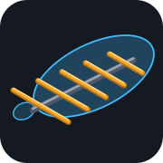
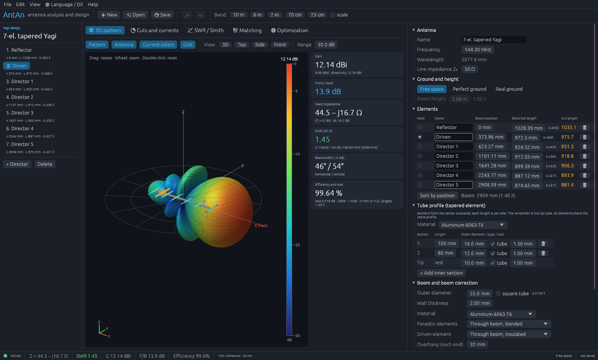
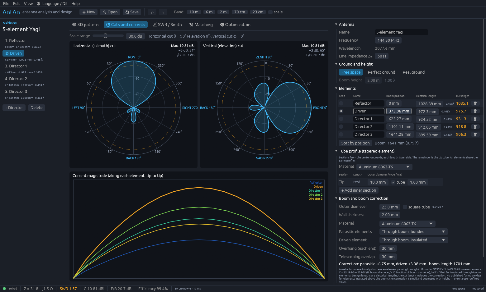
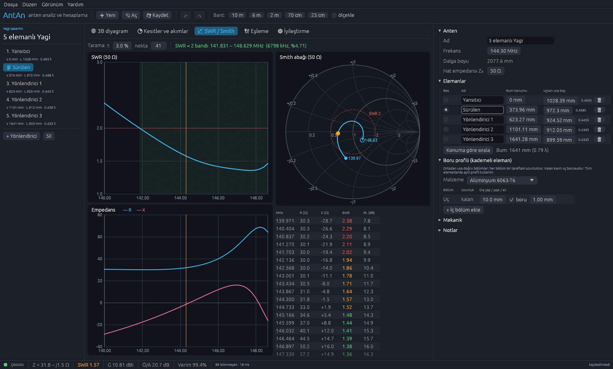
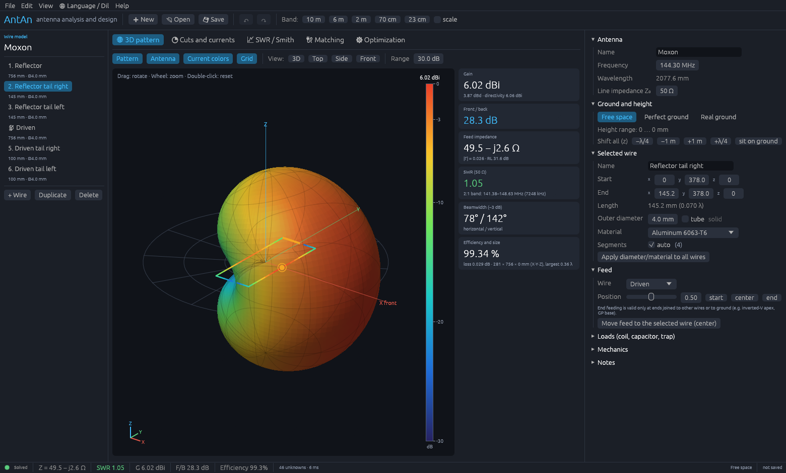
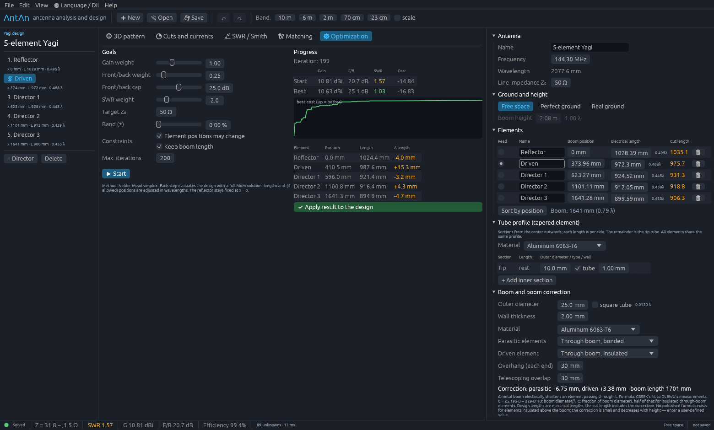
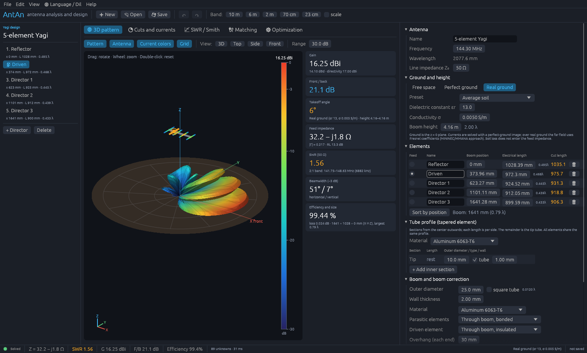
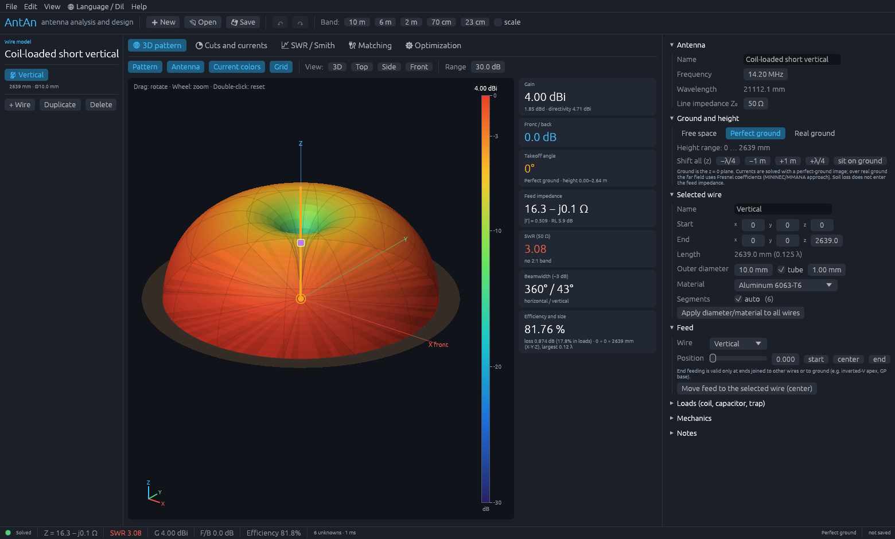
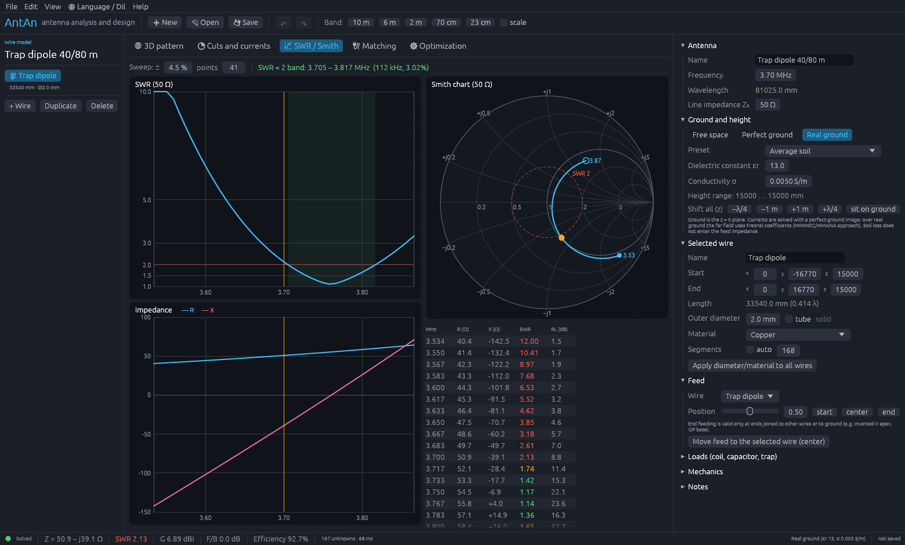

<p align="center"></p>

# AntAn

[English](README.md) · **Türkçe**

**[Kullanma kılavuzu](docs/kullanim-kilavuzu.md)** · [User guide (English)](docs/user-guide.md) · [İndir (Windows 64/32 bit, Linux)](https://github.com/sozden/AntAn/releases/latest)

EZNEC/MMANA tarzı, sıfırdan Rust ile yazılmış bir **anten analiz ve hesaplama programı**.
Kendi moment yöntemi (MoM) çözücüsü, eleman bazlı Yagi tasarımı (kademeli/teleskopik borular
dahil), zemin modeli, toplu yükler ve tuzaklar, bum düzeltmesi ve kesim listesi, 3B ışıma diyagramı,
Smith abağı, eşleme hesapları ve otomatik iyileştirme içerir. Arayüz **İngilizce ve Türkçe**
kullanılabilir (Language / Dil menüsü; seçim hatırlanır). Küçük ekranlar için yazı boyutu
ayarlanabilir (Görünüm → Yazı boyutu, Ctrl +/−).



| Kesitler ve akımlar | SWR, empedans ve Smith |
|---|---|
|  |  |
| **Moxon (tel modeli)** | **İyileştirme** |
|  |  |

## Özellikler

**Modeller**
- **Yagi tasarımı (eleman bazlı):** elemanlar mm cinsinden bum konumu ve uçtan uca boy ile
  düzenlenir. Ortak **boru profili**: ortadan uca kalınlaşan/incelen bölümler (ör. 16 → 12 → 10 mm),
  her bölüm için dış çap, içi dolu / boru ve et kalınlığı, malzeme seçimi.
- **Tel modeli:** her tel başlangıç/bitiş koordinatı (mm), çap, et kalınlığı, malzeme, parça sayısı.
  Teller uç uca değdiğinde otomatik **birleşim** oluşur (köşe, T, radyal yıldız).
- Şablonlar: 2–11 elemanlı Yagi, kademeli Yagi örneği, **LFA Yagi** (halka beslemeli, 3–11 eleman),
  yarım dalga dipol, ters V, katlanmış dipol, **bobinle kısaltılmış dipol**, 2 elemanlı quad, delta
  loop, ground plane (eğik radyalli), Moxon dikdörtgeni, zemine bağlı çeyrek dalga dikey, tuzaklı
  40/80 m dipol, bobin yüklü kısa dikey.
- **LFA sürülen halka:** her Yagi'nin sürülen elemanı, eleman düzleminde yatan dikdörtgen halka
  (G0KSC tarzı) yapılabilir; arka kenarın ortasından beslenir, halka genişliği ayarlanır.
- **Anten önerileri:** bir frekans girin; AntAn uygun bütün anten türlerini kurup çözer, kazanç,
  Ö/A, empedans, SWR ve boyutu yan yana listeler; istenen tek tıkla açılır.
- **Tel uçları arası boşluklar** (ör. Moxon'da sürülen–yansıtıcı boşluğu) listelenir ve 3B'de ölçülendirilir.
- Malzemeler: Al 6063-T6, Al 6061-T6, bakır, pirinç, paslanmaz 304, kayıpsız.

**Analiz**
- Giriş empedansı, SWR, dönüş kaybı, ışıma verimi (deri etkisi ve boru et kalınlığıyla iletken kaybı).
- Kazanç (dBi/dBd), yönlülük, ön/arka oranı, yatay/düşey −3 dB huzme genişliği.
- **3B diyagram:** aydınlatmalı, kazanca göre renklendirilmiş yüzey; ortada akım genliğine göre
  renkli anten; döndürme, yakınlaştırma, hazır bakışlar (3B/üst/yan/ön), renk ölçeği.
- Yatay ve düşey **kutupsal kesitler** (fareyle okuma), elemanlar boyunca **akım dağılımı**.
- **Frekans taraması** (arka planda, tüm çekirdeklerde paralel): SWR, R/X grafikleri,
  **Smith abağı**, 2:1 bant genişliği, değer tablosu.

**Zemin**
- Serbest uzay, **kusursuz zemin** (görüntü yöntemi) ve **gerçek zemin** (εr, σ; deniz suyu,
  ortalama toprak, kayalık vb. hazır değerler).
- Zemine değen tel uçları zemine bağlanır ve tabandan beslenebilir (monopol, dikey antenler).
- Gerçek zemin: akımlar kusursuz zeminle, uzak alan Fresnel yansıma katsayılarıyla hesaplanır
  (MININEC/MMANA yaklaşımı) → gerçekçi düşük açı kazancı ve **kalkış açısı**. Toprak kaybı
  besleme empedansına girmez.
- Yagi için bum yüksekliği, tel modeli için en alt nokta yüksekliği (m / λ); zemin açılınca tel
  modeli otomatik yükseltilir.
- **Yükseklik taraması:** yüksekliğe göre kazanç ve kalkış açısı (Ö/A, empedans, SWR tablosuyla);
  grafiğe tıklayınca o yükseklik uygulanır.
- Zemin üzerinde azimut kesiti kalkış açısında alınır; ön/arka aynı yükseliş açısında ölçülür;
  iyileştirici kazancı kalkış açısında değerlendirir.



**Yüklemeler (bobin, kondansatör, tuzak)**
- Toplu yükler: seri RLC, paralel RLC, Q değeriyle tuzak (paralel LC, f₀), sabit R + jX. Tel içi
  düğüme ya da iki telin birleştiği uca konur; düğümün öz empedansına seri girer (NEC LD gibi).
- Yük kaybı verime yansır; 3B görünümde mor kare işaretçi; verim kartında yüklerdeki kayıp payı.
- Yagi'de eleman yükleri: ortada tek yük ya da iki kolda simetrik çift (kısaltılmış HF Yagi).
- **"L'yi rezonansa ayarla":** bobin endüktansı, gerçek çözücüyle besleme reaktansı sıfır olana
  kadar yinelenir.
- Şablonlar: W3DZZ tarzı tuzaklı 40/80 m dipol, ortadan bobin yüklü λ/8 dikey.

| Bobin yüklü kısa dikey | Tuzaklı dipol 80 m |
|---|---|
|  |  |

**Bum düzeltmesi ve kesim listesi (Yagi)**
- Bum: çap (yuvarlak/kare), et kalınlığı, malzeme, uç taşması; parazitik ve sürülen eleman için
  ayrı bağlanış: bumdan geçen temaslı, bumdan geçen yalıtılmış, düzeltmesiz (yalıtkan bum),
  kullanıcı tanımlı (ör. bum üstüne monte).
- Düzeltme: G3SEK'in DL6WU ölçümlerine uydurduğu C = 25.195·B − 229·B² (B = bum çapı/λ,
  C = bum çapının kesri, tüm eleman boyuna eklenir); yalıtılmış geçişte yarısı. B > 0.055 λ'da uyarı.
- Tasarımdaki boylar **elektriksel** boydur (çözücü bunu kullanır); tabloda ayrıca **kesim boyu**.
- **Kesim listesi:** her elemanın bölüm bölüm boruları (adet, kesim boyu, çap × et; geçme payı ve
  uçta bum düzeltmesi dahil), boru türüne göre toplam ihtiyaç, panoya kopyalama.
- Bum kütlesi ve rüzgâr yükü mekanik toplamlara eklenir; 3B görünümde bum çizilir.

**Eşleme**
- L devresi (tüm çözümler, kontrol empedansıyla), hairpin (beta) boyu ve endüktansı,
  gamma çubuğu boyu ve seri kondansatörü.
- **Hairpin'i modele takma:** SWR, empedans, tarama ve Smith abağı hat tarafından, hairpin dahil
  gösterilir (frekansa bağlı reaktans).
- **Z₀'a eşle (tek tıkla):** eşleme düzeneği olmadan besleme hatla eşleşene kadar yalnız sürülen
  elemanı ve ilk yönlendiriciyi (boy ve konum) ayarlar; kazanç ve diyagram korunur.
- **Sürülen elemanı otomatik ayarla:** rezonansa (X = 0) veya hairpin için gereken kapasitif
  reaktansa, gerçek çözücüyle yinelenerek.

**İstif**
- Herhangi bir antenin iki, üç ya da dört kopyası üst üste, yan yana ya da 2 × 2 H çerçeve olarak
  dizilir, ideal güç bölücüyle aynı fazda beslenir; karşılıklı etki çözümün parçasıdır.
- Huzme genişliğinden DL6WU aralık önerisi, aralık taraması (kazanç ve en yüksek yan lob), her
  antenin besleme empedansı ve bölücü girişindeki empedans.

**Manyetik loop**
- Ayar kondansatörlü ve kuplaj halkalı küçük verici halka (sekizgenden ≈ daireye). Frekans
  değişince kondansatör kendiliğinden yeniden ayarlanır; kuplaj halkası tek tıkla 50 Ω'a eşlenir.
- Bant boyunca gereken kondansatör, verici gücünde kondansatör gerilimi, halka Q'su ve bant
  genişliği, kondansatör kaybı dahil verim gösterilir. Kondansatör yerinin iki kapılı modeli
  sayesinde ayar ve eşleme anında yapılır.

**İyileştirme (Yagi)**
- Nelder-Mead; hedefler: kazanç, ön/arka (tavanlı), SWR; isteğe bağlı bant (±%) değerlendirmesi;
  bum boyunu koruma, konumları sabit tutma seçenekleri. Arka planda çalışır, ilerleme grafiği,
  eleman bazında Δ boy tablosu; sonuç tek tıkla uygulanır (Ctrl+Z ile geri alınır).

**Mekanik**
- Eleman kütlesi, ortadan tutulan **kademeli elemanın kendi ağırlığıyla uç sarkması**
  (sayısal konsol kiriş), rüzgâr alanı ve verilen hızda rüzgâr kuvveti.

**Dosya**
- Proje: `.antan` (JSON, okunabilir). NEC-2 kart dosyası dışa aktarımı (GW, GE/GN, LD, EX, FR, RP) (4nec2/xnec2c/EZNEC ile
  karşılaştırma için). Pencereyi PNG kaydetme. Geri al/yinele (Ctrl+Z / Ctrl+Y), Ctrl+O / Ctrl+S.
- 160 m'den 13 cm'ye bütün amatör bantları içeren Bant menüsü; isteğe bağlı olarak geometriyi yeni
  frekansa ölçekler. Frekans aralığı 0.1–3000 MHz; elektriksel olarak çok büyük model bellek
  tüketmek yerine mesajla reddedilir ve tek tıkla "anteni bu frekansa ölçekle" önerilir.

## Derleme ve çalıştırma

Güncel kararlı Rust araç zinciri gerekir (edition 2024).

```
cargo run --release -p antan
```

Testler (çözücü doğrulamaları dahil):

```
cargo test --workspace --release
```

## Mimari

```
crates/
  antan-core/   arayüzden bağımsız hesap motoru
    solver.rs     MoM çözücü (birleşimler, birleşimden besleme, iletken kaybı)
    farfield.rs   uzak alan, kazanç, örüntü özeti, kesitler
    yagi.rs       eleman bazlı Yagi tasarımı, kademeli profil, sürülen eleman ayarı
    templates.rs  tel modeli şablonları
    matching.rs   SWR, L devresi, hairpin, gamma
    optimize.rs   Nelder-Mead iyileştirici
    mechanics.rs  kütle, kademeli kiriş sarkması, rüzgâr
    material.rs   malzemeler, boru iç empedansı (deri etkisi)
    nec.rs        NEC-2 dışa aktarımı
    stack.rs      istif, DL6WU aralığı, aralık taraması
    magloop.rs    manyetik loop, iki kapılı ayar, kuplaj halkası eşleme
    i18n.rs       İngilizce / Türkçe metinler
    tests/        doğrulama testleri
    examples/explore.rs  şablon boyutlarını taramak için keşif aracı
    examples/validate.rs NEC-2 / MININEC karşılaştırma modelleri (bkz. docs/dogrulama.md)
  antan-app/    egui masaüstü arayüzü (koyu tema); build.rs exe simgesini gömer
assets/         logo.svg (kaynak) ve üretilmiş simgeler
tools/          make-icons.ps1 — simgeleri logo.svg'den yeniden üretir;
                validation/ — nec2c ve pymininec ile karşılaştırma
docs/           kullanma kılavuzları (TR/EN) ve ekran görüntüleri
```

Eksenler: +X bum yönü (ileri), Y eleman ekseni, +Z yukarı. Birimler çekirdekte SI, arayüzde mm.

## Çözücü ve doğrulama

İnce tel moment yöntemi, Harrington'ın karışık potansiyelli darbe tabanlı / nokta eşlemeli
formülasyonu; indirgenmiş çekirdek, tekil kısım analitik. N telin buluştuğu noktada N−1 birleşim
tabanı kurulur (Kirchhoff kendiliğinden sağlanır). Otomatik bölme dalga boyu başına 40 parçadır ama
parça boyu tel yarıçapının iki katından kısa olmaz; 0.02 λ'dan kalın iletkenlerde geçerlilik uyarısı
verilir, 0.1 λ'nın üstünde model çözülmez. Yagi şablonları eleman boylarını boru kalınlığına
(çap/λ) göre düzeltir. Testlerle doğrulananlar:

- İnce yarım dalga dipol ≈ 73 + j42 Ω, 2.15 dBi; parça sayısıyla yakınsama
- Kayıpsız antenlerde enerji korunumu (kazanç = yönlülük, ±0.05 dB) — birleşimli antenler dahil
- GP tabanında Kirchhoff akım yasası; birleşimden besleme = ortadan besleme
- Üç parçaya bölünmüş dipol = tek parça dipol
- Yükler: beslemedeki seri yük empedansa birebir eklenir; dirençli yükte kazanç = yönlülük + verim;
  tuzak rezonansta ≈ Q·ω₀·L; tuzaklı dipol iki bantta SWR < 2; simetrik yük çiftinde eşit akım;
  %70 boylu, bobin yüklü 2 elemanlı Yagi ileri yönde > 5 dBi
- Bum düzeltmesi: SM5BSZ tablosundaki örnek (19.05 mm bum, 144 MHz, yalıtılmış → +2.01 mm);
  kesim listesi toplamının elektriksel boy + düzeltmeye eşitliği
- Zemin: kusursuz zemin sonucu = serbest uzayda elle kurulmuş "anten + görüntü" çifti (yatay ve
  dikey, 1e-6 içinde); λ/4 monopol = dipol/2 ve +3.01 dB; λ/2 yükseklikte yatay dipolün kalkış
  açısı 30° (8.4 dBi); gerçek zeminde dikey polarizasyonun ufukta sönmesi; çok iletken gerçek
  zeminin kusursuz zemine yakınsaması
- Katlanmış dipol ≈ eşdeğer yarıçap modeli; Moxon, quad için ileri yönlülük ve yüksek Ö/A
- İletken iç empedansının DC ve deri etkisi sınırları; L devresi/hairpin çözümlerinin geri kontrolü

Şablon boyutlarının bir kısmı (quad, delta, GP, Moxon için ×1.012) bu çözücüyle taranarak
ayarlanmıştır.

**NEC-2 ve MININEC ile karşılaştırma:** 20 anten aynı geometriyle AntAn'da, `nec2c`'de (NEC-2) ve
`pymininec`'te (MININEC, MMANA-GAL'ın çekirdeği) çalıştırıldı. Kazanç NEC-2 ile 0,06 dB (medyan; en
çok 0,37 dB), MININEC ile 0,01 dB içinde uyuşuyor. Verim ve istif kazancı NEC-2 ile aynı. Borudan
yapılmış antenlerde AntAn, MININEC gibi, rezonans frekansını NEC-2'den yaklaşık %1 yüksek buluyor.
Tablolar ve yöntem: [docs/dogrulama.md](docs/dogrulama.md).

Etkileşimsiz arayüz doğrulaması: `ANTAN_AUTOSHOT=<png yolu>` ile başlatılan program tarama
bitince pencerenin görüntüsünü kaydedip kapanır. `ANTAN_AUTOSHOT_TAB=cuts|sweep|matching|optim`,
`ANTAN_AUTOSHOT_TEMPLATE=yagi7|moxon|quad|gp|vertical|yagi_ground|trap|loaded|lfa|loaded_dipole|dipole_ground`,
`ANTAN_AUTOSHOT_WINDOW=suggest|height|stack`, `ANTAN_AUTOSHOT_STACK=2x1|2x2|…`, şablon `magloop|magloop14`, `ANTAN_AUTOSHOT_FREQ=<MHz>`, `ANTAN_AUTOSHOT_HAIRPIN=1`, `ANTAN_AUTOSHOT_OPTIM=<adım>`, `ANTAN_AUTOSHOT_SIZE=1560x1400`, `ANTAN_AUTOSHOT_OPEN_ALL=1`, `ANTAN_LANG=en|tr`, `ANTAN_SCALE=1.3` ek seçeneklerdir.

## Yol haritası

- Tel modelleri için iyileştirici (ve LFA halka genişliği)
- Gerçek zeminin akımlara etkisi (Sommerfeld/Norton) ve toprak kaybının empedansa yansıması
- Gömülü radyal sistemi kaybı tahmini
- Faz beslemesi (aynı fazlı istif dışında)
- Rezonans frekansının daha hızlı yakınsaması (parça inceltme ya da daha yüksek dereceli taban)
- MMANA `.maa` ve NEC içe aktarma; PDF/HTML rapor

## Kaynaklar ve atıflar

Yöntemler ve formüller yayımlanmış literatürden alınmış, kod sıfırdan yazılmıştır:

- Moment yöntemi: R. F. Harrington, *Field Computation by Moment Methods* (1968) — karışık
  potansiyelli darbe tabanlı / nokta eşlemeli formülasyon
- Gerçek zemin: Fresnel yansıma katsayıları; MININEC/MMANA'daki yansıma katsayısı yaklaşımı
- Moxon boyutları: L. B. Cebik (W4RNL), MoxGen eğri uydurması
- Tuzaklı dipol şablonu: C. L. Buchanan (W3DZZ) tasarımı
- Katlanmış dipol karşılaştırması: eşdeğer yarıçap modeli (klasik anten ders kitapları)

### Bum düzeltmesi

- [SM5BSZ — Boom corrections from various sources](https://sm5bsz.com/antennas/sa/others.htm)
- [YU1AW — Yagi boom correction](https://www.qsl.net/yu1aw/Misc/yagi_boom_correction.pdf)
- [DK7ZB — Yagi details](https://www.qsl.net/d/dk7zb/2m-short/detail.htm)

## Teşekkürler

AntAn'ı test edip geri bildirimleriyle gelişmesine katkıda bulunan radyo amatörlerine çok teşekkürler:

| Çağrı işareti | Ad | Katkı |
|---|---|---|
| TA7MVL | Mevlüt | Test ve geri bildirim (v0.2.0) |
| TA6TTT | Asım | Test ve geri bildirim (v0.2.0) |
| TA1OZV | Tayfun | Test ve geri bildirim (v0.2.0) |

Her türlü katkı — test, hata bildirimi, öneri, kod — memnuniyetle karşılanır ve burada çağrı işareti
ve adıyla anılır.

## Lisans

AntAn, isteğinize göre aşağıdakilerden biriyle lisanslanmıştır:

- Apache Lisansı 2.0 ([LICENSE-APACHE](LICENSE-APACHE))
- MIT Lisansı ([LICENSE-MIT](LICENSE-MIT))

Aksini açıkça belirtmedikçe, bu projeye kasıtlı olarak gönderdiğiniz her katkı, Apache-2.0
lisansında tanımlandığı şekilde, ek koşul olmaksızın yukarıdaki gibi çift lisanslı kabul edilir.

### Üçüncü taraf bileşenler

Bağımlılıkların tamamı izin verici lisanslıdır (MIT, Apache-2.0, BSD, Zlib, ISC, BSL-1.0,
Unicode-3.0); ayrıntı için `cargo metadata`. Derlenmiş programa gömülen egui varsayılan yazı
tipleri (Ubuntu, Noto Emoji) Ubuntu Font Licence 1.0 ve SIL Open Font License 1.1 kapsamındadır.
Windows'ta simgeler için sistemdeki Segoe UI Symbol yazı tipi çalışma anında okunur; programla
dağıtılmaz.
