<p align="center">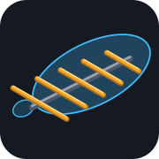</p>

# AntAn kullanma kılavuzu

[English](user-guide.md) · **Türkçe**

AntAn bir anten analiz ve tasarım programıdır. Bir anteni tarif edersiniz: Yagi'yi elemanları ve
borularıyla, herhangi bir anteni de teller kümesi olarak. AntAn empedansını, SWR'sini, kazancını,
ışıma diyagramını, eşleme devrelerini ve kesilecek boru boylarını hesaplar. Bu kılavuz programı
önce adım adım bir örnekle, sonra her özelliği ayrı ayrı anlatır.

## İçindekiler

1. [Kurulum](#1-kurulum)
2. [Ekran](#2-ekran)
3. [Önce bilinmesi gerekenler](#3-önce-bilinmesi-gerekenler)
4. [Uygulama: 2 m için 5 elemanlı Yagi](#4-uygulama-2-m-için-5-elemanlı-yagi)
5. [Sonuçları okumak](#5-sonuçları-okumak)
6. [Eşleme](#6-eşleme)
7. [İyileştirme](#7-iyileştirme)
8. [Zemin ve yükseklik](#8-zemin-ve-yükseklik)
9. [Tasarımdan atölyeye: bum düzeltmesi ve kesim listesi](#9-tasarımdan-atölyeye-bum-düzeltmesi-ve-kesim-listesi)
10. [Tel modelleri: her tür anten](#10-tel-modelleri-her-tür-anten)
11. [Yükler: bobin, kondansatör ve tuzak](#11-yükler-bobin-kondansatör-ve-tuzak)
12. [Anten önerileri](#12-anten-önerileri)
13. [LFA Yagi (halka beslemeli)](#13-lfa-yagi-halka-beslemeli)
14. [İstif](#14-i̇stif)
15. [Manyetik loop](#15-manyetik-loop)
16. [Dosyalar](#16-dosyalar)
17. [Klavye kısayolları](#17-klavye-kısayolları)
18. [Sorun giderme](#18-sorun-giderme)
19. [Doğruluk ve sınırlar](#19-doğruluk-ve-sınırlar)

## 1. Kurulum

**Windows (hazır program)**

1. [Sürümler sayfasını](https://github.com/sozden/AntAn/releases) açın ve
   `AntAn-<sürüm>-windows-x64.zip` (64 bit Windows, neredeyse her bilgisayar) ya da
   `AntAn-<sürüm>-windows-x86.zip` (32 bit Windows) dosyasını indirin.
2. Zip'i istediğiniz yere (örneğin Masaüstü) açın ve `AntAn.exe`'ye çift tıklayın. Kurulum gerekmez.
3. Program dijital olarak imzalı olmadığı için Windows SmartScreen ilk açılışta uyarı verebilir:
   **Ek bilgi → Yine de çalıştır**'a tıklayın.

**Linux (hazır program, x86-64)**

1. Sürümler sayfasından `AntAn-<sürüm>-linux-x64.tar.gz` dosyasını indirin.
2. Açın ve çalıştırın:
   ```
   tar xzf AntAn-<sürüm>-linux-x64.tar.gz
   cd AntAn-<sürüm>-linux-x64
   ./antan
   ```
3. glibc 2.35 ya da daha yenisi (Ubuntu 22.04+, Debian 12+, Fedora 36+, Linux Mint 21+) ve X11 ya
   da Wayland ile OpenGL destekli bir masaüstü gerekir. Dosya pencereleri masaüstü portalını
   (`xdg-desktop-portal`) kullanır; normal masaüstlerinde zaten vardır. `install-desktop.sh`, AntAn'ı
   simgesiyle uygulama menüsüne ekler (isteğe bağlı, yalnız o kullanıcı için).

**Kaynak koddan (Rust kurulu her sistemde)**

```
git clone https://github.com/sozden/AntAn
cd AntAn
cargo run --release -p antan
```

**Dil.** Arayüz İngilizce açılır. **🌐 Language / Dil** menüsünden Türkçe'yi seçin; seçim hatırlanır.

**Yazı boyutu.** Küçük ya da yüksek çözünürlüklü ekranda **Görünüm → Yazı boyutu** (%85 … %200) ya da
**Ctrl +** / **Ctrl −** kullanın (**Ctrl 0** sıfırlar). Bütün arayüz ölçeklenir ve ayar hatırlanır;
yan paneller pencereyle daralır, geniş tablolar yana kaydırılır.

## 2. Ekran

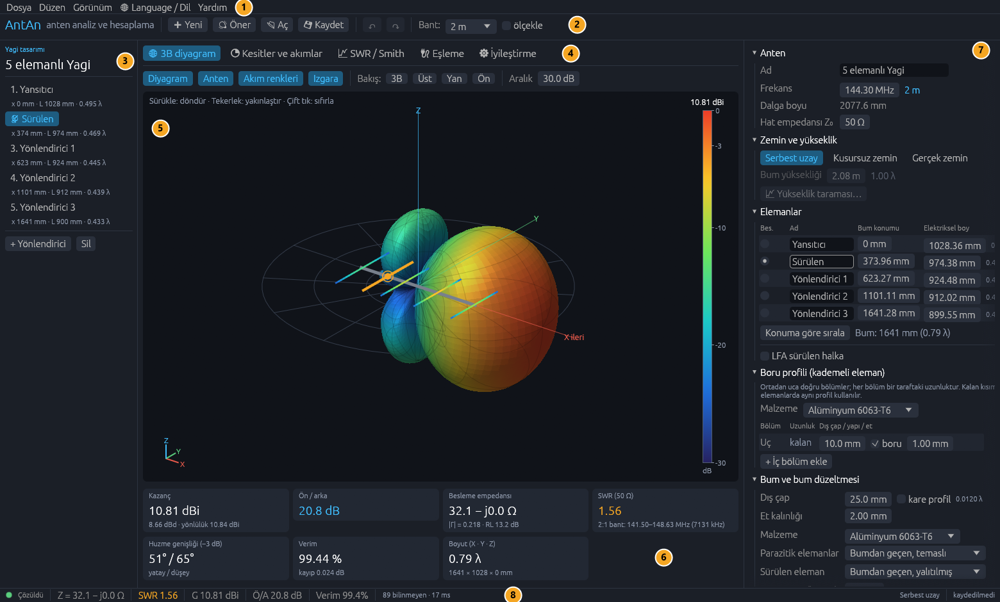

| No | Bölüm | Ne işe yarar |
|---|---|---|
| 1 | Menü çubuğu | Dosya, Düzen, Görünüm, Language / Dil, Yardım |
| 2 | Araç çubuğu | Yeni, **💡 Öner**, Aç, Kaydet, geri al/yinele, **Bant** menüsü (160 m … 13 cm) ve **ölçekle** seçeneği |
| 3 | Model listesi | Elemanlar (Yagi) ya da teller (tel modeli). Birine tıklayınca 3B'de turuncu yanar, ayarları sağda açılır |
| 4 | Sekmeler | 3B diyagram, Kesitler ve akımlar, SWR / Smith, Eşleme, İyileştirme |
| 5 | Görünüm alanı | Seçili sekmenin içeriği |
| 6 | Sonuç kartları | 3B diyagramın altında yan yana: kazanç, ön/arka, (kalkış açısı), besleme empedansı, SWR ve 2:1 bant, huzme genişliği, verim, boyut |
| 7 | Özellikler | Antenin bütün ayarları, açılır kapanır bölümler halinde |
| 8 | Durum çubuğu | Empedans, SWR, kazanç, Ö/A, verim, çözüm süresi; hata mesajları burada çıkar |

## 3. Önce bilinmesi gerekenler

- **"Hesapla" düğmesi yoktur.** Her değişiklik anında çözülür. Frekans taraması arka planda, bütün
  işlemci çekirdeklerinde çalışır; bu sırada dönen bir gösterge görünür.
- **Geri al** Ctrl+Z, **yinele** Ctrl+Y. Büyük işlemler (şablon yükleme, iyileştirme sonucunu
  uygulama) her zaman geri alınabilir.
- **Birimler:** arayüzde uzunluklar milimetre, frekanslar MHz'dir. Birçok alanda değerin dalga boyu
  (λ) karşılığı da yazar.
- **Sayı girmek:** sayı alanını fareyle sağa sola sürükleyin ya da çift tıklayıp yazın.
- **Eksenler:** +X ileri (bum boyunca, Yagi'nin ışıdığı yön), Y eleman ekseni, +Z yukarı. Zemin
  kullanılıyorsa z = 0 düzlemidir.

## 4. Uygulama: 2 m için 5 elemanlı Yagi

### 4.1 Tasarımı başlatın

**➕ Yeni → 5 elemanlı Yagi**'yi seçin. AntAn genel geçer ölçülerle bir başlangıç tasarımı kurar.
Bu bir taslaktır; sonraki adımlarda kendi bandınıza ve borularınıza göre uyarlayacaksınız.

### 4.2 Frekans ve besleme hattı

Sağ paneldeki **Anten** bölümünde:

- **Frekans:** 144.300 MHz (ya da **Bant** menüsünden **2 m**). Alan 0.1 … 3000 MHz kabul eder ve
  frekansın hangi amatör bantta olduğunu yazar.
- **Hat empedansı Z₀:** kullandığınız koaksiyel, genelde 50 Ω. SWR bu değere göre hesaplanır.

> **İpucu:** Bant menüsünün yanındaki **ölçekle** kutusu bant seçince ne olacağını belirler.
> İşaretsizse yalnız analiz frekansı değişir. İşaretliyse anten yeni dalga boyuna göre baştan
> ölçeklenir — 2 m tasarımını 70 cm'ye çevirmek için kullanışlıdır. Frekans, geometrinin yapıldığı
> frekanstan çok uzaklaşırsa frekansın altında bir uyarı ve **Anteni bu frekansa ölçekle** düğmesi
> çıkar. Seçilen frekansta elektriksel olarak çok büyük kalan model çözülmez (çok bellek isterdi);
> program donmak yerine bunu bildirir.

### 4.3 Borular


**Boru profili (kademeli eleman)** bölümünde:

- **Malzeme**'yi seçin (ör. Alüminyum 6063-T6).
- **Uç** satırı elemanlarda kullanılan borudur: dış çap (ör. 10 mm). **boru** işaretliyse et
  kalınlığını girin (ör. 1 mm); işaretsizse içi dolu çubuk sayılır.
- **Teleskopik (kademeli) elemanlar** için (ortası kalın, uçlara doğru incelen) **+ İç bölüm ekle**'ye
  tıklayın. Her satır ortadan dışa doğru bir bölümdür; uzunluğu tek taraftakidir. Örnek: 100 mm Ø16,
  sonra 80 mm Ø12, geri kalanı Ø10. Bütün elemanlar aynı profili kullanır.

Çap, et kalınlığı ve malzeme hesaba girer (iletken kaybı ve deri etkisi).
Yeni bir Yagi'nin eleman boyları boru kalınlığına göre zaten düzeltilmiştir: dalga boyuna göre
kalın bir boru daha kısa boyda rezonansa gelir; bu yüzden aynı 10 mm boru 70 cm'de 2 m'dekinden daha
kısa elemanlar verir. Yeni Yagi'nin sürülen elemanı rezonansa (X = 0) ayarlanır. **ölçekle**
işaretliyken bant değiştirince de aynı düzeltme uygulanır.

### 4.4 Eleman konumları ve boyları

**Elemanlar** tablosunda her eleman bir satırdır:

- **Bes.** sürülen (beslenen) elemanı işaretler.
- **Bum konumu** — yansıtıcı genelde 0 mm, diğerleri onun önünde.
- **Elektriksel boy** — çözücünün kullandığı uçtan uca boy. Yanında λ karşılığı yazar.
- **Kesim boyu** — salt okunur; bum düzeltmesi eklenmiş, gerçekte keseceğiniz boy (9. bölüm).

Eleman eklemek ve silmek için model listesinin altındaki **+ Yönlendirici / Sil** düğmelerini ya da
tablodaki 🗑'yi kullanın. **Konuma göre sırala** listeyi düzenler.

### 4.5 Sonuca bakın

**🌐 3B diyagram** sekmesini açın. Renkli yüzey ışıma diyagramıdır (kırmızı en güçlü yön, mavi
zayıf). Ortada anten, akımlarına göre renkli olarak çizilir; turuncu halka besleme noktasıdır.
Sürükleyerek döndürün, tekerlekle yakınlaşın, çift tıklayarak sıfırlayın; **Bakış** düğmeleri 3B /
üst / yan / ön görünümleri verir.

Diyagramın altındaki kartlar (2. bölümdeki 6 numara) tasarımı özetler: dBi ve dBd cinsinden kazanç, ön/arka oranı,
besleme empedansı, SWR (yeşil iyi, sarı orta, kırmızı kötü) ve 2:1 bant genişliği, huzme genişliği,
verim ve boyut.

## 5. Sonuçları okumak

### Kesitler ve akımlar


- **Yatay (azimut) kesit** — diyagramın yukarıdan görünüşü. İLERİ yukarıdadır.
- **Düşey (yükseliş) kesit** — yandan görünüş. Zemin varken kalkış açısını gösterir.
- Kesikli halka −3 dB'dir; sağ üstte en yüksek kazanç, −3 dB huzme genişliği ve Ö/A yazar.
  Fareyi grafiğin üzerinde gezdirince her açıdaki kazancı okursunuz.
- **Akım genliği** her eleman boyunca (uçtan uca). Seçili eleman turuncu çizilir.

### SWR, empedans ve Smith abağı


- Üstte tarama aralığını (merkez frekansın ± %'si) ve nokta sayısını ayarlayın.
- **SWR grafiğinde** SWR < 2 olan bant yeşil gölgelidir; sınırları en üstte yazar.
- **Empedans grafiği** R (mavi) ve X (pembe) değerlerini gösterir.
- **Smith abağı** tarama boyunca empedansın izlediği yolu gösterir; kesikli çember SWR 2, sarı nokta
  tasarım frekansıdır.
- Herhangi bir grafiğin üzerinde gezinince frekans, empedans ve SWR görünür. Tabloda değerler listelenir.

## 6. Eşleme

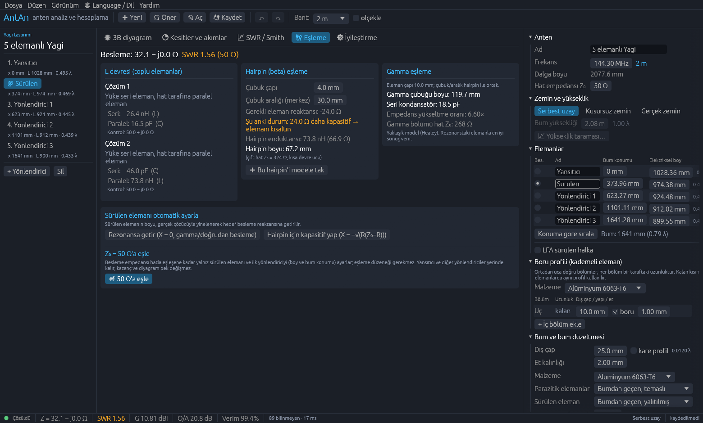

Besleme empedansı Z₀'a eşit değilse **🔌 Eşleme** sekmesi üç çözüm sunar:

- **L devresi** — olası her düzen için bobin ve kondansatör değerleri (nH, pF), sonuç empedansının
  kontrolüyle birlikte.
- **Hairpin (beta) eşleme** — çubuk çapını ve aralığını girin; hairpin boyunu ve endüktansını
  verir. Hairpin için sürülen eleman biraz *kısa* (kapasitif) olmalıdır; kart elemanı kısaltmanız mı
  uzatmanız mı gerektiğini söyler.
- **Gamma eşleme** — gamma çubuğu boyu, seri kondansatör ve yükseltme oranı (yaklaşık bir model;
  rezonanstaki elemanla en iyi sonuç verir).

Hairpin kartındaki **➕ Bu hairpin'i modele tak**, hesaplanan hairpin'i besleme noktasına paralel
bağlar. Bundan sonra besleme empedansı, SWR, sonuç kartları ve bütün tarama/Smith abağı hat
tarafından, hairpin dahil gösterilir (reaktansı frekansla değişir). Takılı değer yeşil şeritte
değiştirilebilir ya da çıkarılabilir. Aşağıdaki *Hairpin için kapasitif yap* ile birlikte
kullanınca eşlenmiş son SWR eğrisini görürsünüz.

**Sürülen elemanı otomatik ayarla**, sürülen eleman boyunu gerçek çözücüyle değiştirir:
*Rezonansa getir* (X = 0, gamma ya da doğrudan besleme için) veya *Hairpin için kapasitif yap*.
Sonuç tasarıma uygulanır ve geri alınabilir.

**🎯 Z₀'a eşle**, besleme empedansını eşleme düzeneği *olmadan* hat empedansına (ör. 50 Ω) getirir.
Yalnız sürülen elemanı ve ilk yönlendiriciyi — boylarını ve bum konumlarını — değiştirir; yansıtıcı
ve diğer yönlendiriciler yerinde kalır, bu yüzden kazanç ve diyagram pek değişmez. Arka planda bir
iki saniye çalışır; sonuç satırı SWR, kazanç ve Ö/A'nın önceki ve sonraki değerlerini gösterir,
Ctrl+Z geri alır. Örnek: 70 cm için 7 elemanlı bir Yagi 0,2 dB kazanç karşılığında SWR 2,32'den
1,00'e indi. Bütün elemanları içeren yeniden tasarım için İyileştirme sekmesini yüksek SWR
ağırlığıyla kullanın.

## 7. İyileştirme

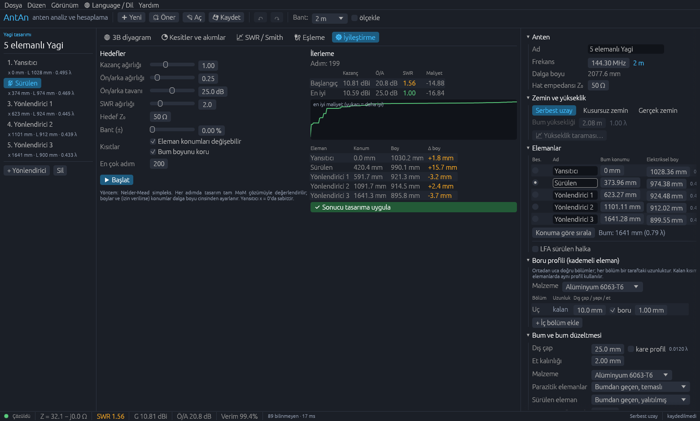

**⚙ İyileştirme** sekmesi bir Yagi'yi otomatik olarak ayarlar.

1. **Hedefleri** belirleyin: kazanç, ön/arka ve SWR ağırlıkları. Ağırlık büyüdükçe "bu daha önemli"
   demektir. *Ön/arka tavanı*, Ö/A belli bir değerin (ör. 25 dB) üstüne çıkınca artık ödül vermez;
   böylece iyileştirici birkaç dB fazla Ö/A için kazançtan vazgeçmez.
2. **Bant (±)** — 0 yalnız merkez frekansta iyileştirir; örneğin %1 bant kenarlarını da değerlendirir.
3. **Kısıtlar** — eleman konumlarının değişmesine izin verin ya da sabitleyin; *Bum boyunu koru*
   ilk ve son elemanı yerinde tutar.
4. **▶ Başlat**'a tıklayın. Grafik şimdiye kadarki en iyi maliyeti (yukarı daha iyi), tablo her
   elemanın boy değişimini gösterir.
5. Memnunsanız **✔ Sonucu tasarıma uygula**; Ctrl+Z eski tasarımı geri getirir.

İyileştirici her adımda gerçek çözücüyü kullanır; küçük bir Yagi'de birkaç yüz adım birkaç saniye sürer.

## 8. Zemin ve yükseklik

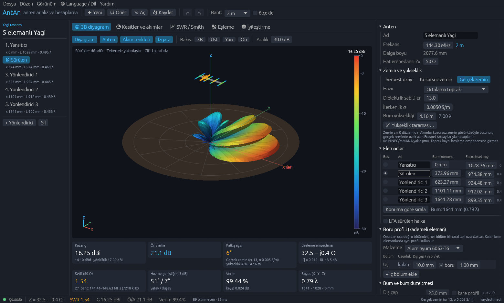

**Zemin ve yükseklik** bölümünde:

- **Serbest uzay** — zemin yok (antenleri tek başına karşılaştırmak için).
- **Kusursuz zemin** — ideal iletken zemin.
- **Gerçek zemin** — **Hazır** listesinden toprak türünü seçin (deniz suyu, ortalama toprak, kayalık
  toprak …) ya da dielektrik sabiti εr ve iletkenlik σ değerlerini girin.
- Yagi'de **Bum yüksekliği**'ni, tel modelinde **Yükseklik (en alt nokta)**'yı girin ya da
  **Tümünü kaydır (z)** / **zemine otur** düğmelerini kullanın. Tel modeli serbest uzaydan zemine
  alınınca otomatik olarak λ/2 (en çok 10 m) yükseğe kaldırılır.
- **📈 Yükseklik taraması…** anteni birçok yükseklikte (ör. 0.1 … 2 λ) çözer; kazancı ve kalkış
  açısını yüksekliğe göre çizer, Ö/A, empedans ve SWR'yi tabloda verir. Fareyle grafikte değer
  okunur; grafiğe tıklayınca (ya da tablodaki *uygula*) o yükseklik modele uygulanır.

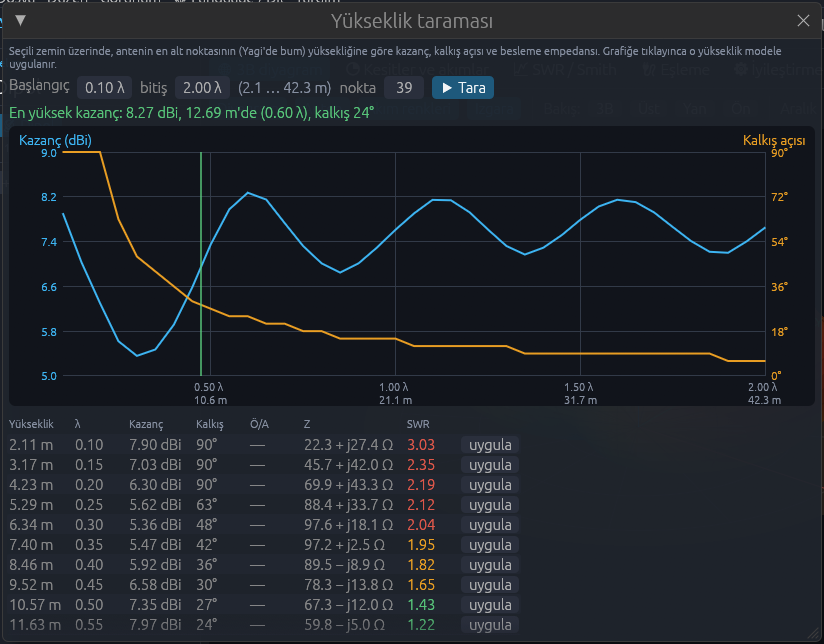

Zemin varken **Kalkış açısı** kartı çıkar: en güçlü ışımanın yükseliş açısı. Anten yükseldikçe açı
düşer (DX için daha iyi). Yatay kesit de bu durumda kalkış açısında alınır.

> Gerçek zeminde AntAn, MININEC/MMANA ile aynı yaklaşımı kullanır: akımlar kusursuz zemin üzerinde
> çözülür, uzak alanda toprağın yansıması hesaba katılır. Bu yüzden toprak kaybı besleme empedansına
> girmez; bu en çok yere yakın dikey antenlerde önemlidir.

## 9. Tasarımdan atölyeye: bum düzeltmesi ve kesim listesi

### Bum düzeltmesi

İçinden geçtiği metal bum, elemanı elektriksel olarak kısaltır; eleman biraz uzun kesilmelidir.
**Bum ve bum düzeltmesi** bölümünde:

- Bumun **dış çapını** (kare profilde **kare profil** işaretleyip kenarını), et kalınlığını ve
  malzemesini girin.
- **Parazitik elemanların** ve **sürülen elemanın** nasıl bağlandığını seçin:
  *bumdan geçen, temaslı*; *bumdan geçen, yalıtılmış* (düzeltmenin yarısı); *düzeltme yok* (yalıtkan
  bum ya da bumdan uzak elemanlar) veya *kullanıcı tanımlı* — örneğin bumun üstüne yalıtkanla monte
  elemanlar için; bunun için yayımlanmış bir formül yoktur.
- Düzeltme (DL6WU/G3SEK formülü) altta ve eleman tablosundaki **Kesim boyu** sütununda görünür.
- *Uç taşması* bumun uç elemanlardan dışarı taşan kısmıdır; *Geçme payı* bir borunun diğerinin içine
  ne kadar girdiğidir.

### Kesim listesi

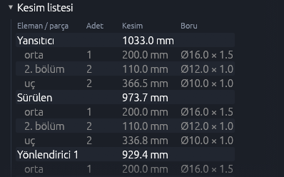

**Kesim listesi** her elemanın her boru parçasını verir: adet, kesim boyu ve çap × et — geçme payı ve
bum düzeltmesi dahil. Altında boru ölçüsüne göre toplam ihtiyaç (fire hariç) yazar.
**📋 Kesim listesini panoya kopyala** listeyi herhangi bir metin düzenleyiciye yapıştırılabilir hale getirir.

### Mekanik

**Mekanik** bölümü her elemanın ve bumun kütlesini, ortadan tutulan her elemanın kendi ağırlığıyla
uç sarkmasını ve girdiğiniz hızdaki rüzgâr yükünü gösterir.

## 10. Tel modelleri: her tür anten


Eleman bazlı Yagi olmayan her şey bir **tel modelidir**.

1. **➕ Yeni → Tel modelleri** hazır antenler sunar: dipol, ters V, katlanmış dipol, bobinle
   kısaltılmış dipol (yarı boy), 2 elemanlı quad, delta loop, ground plane, Moxon, zemine bağlı dikey,
   tuzaklı dipol, bobin yüklü dikey.
   **Düzen → Tel modeline dönüştür** bir Yagi'yi de tellere çevirir.
2. Model listesinden bir tel seçin. **Seçili tel** bölümünde başlangıç ve bitiş koordinatlarını (mm),
   dış çapı, boru/dolu seçimini, malzemeyi ve parça sayısını girin (*otomatik* neredeyse her zaman
   yeterlidir).
3. **Telleri birleştirmek:** iki telin ucunu tam olarak aynı koordinata getirin; AntAn onları
   otomatik bağlar (köşe, T bağlantı, radyaller). Ayrı bir "bağla" komutu yoktur.
4. Model listesinin altındaki **+ Tel / Kopyala / Sil** tel ekler ve siler.
5. **Besleme:** teli ve tel üzerindeki konumu seçin (0 baş, 0.5 orta, 1 son). Uçtan besleme yalnızca
   o uç başka bir telle ya da zeminle birleşiyorsa çalışır — örneğin ters V'nin tepesi ya da dikeyin
   tabanı.

**Tel uçları arası boşluklar.** İki serbest tel ucu birbirine bakıyorsa — ör. Moxon'da sürülen ve
yansıtıcı kuyrukları arası — mesafe **Tel uçları arası boşluklar** bölümünde listelenir ve 3B
görünümde turuncu kesikli ölçü çizgisiyle gösterilir.

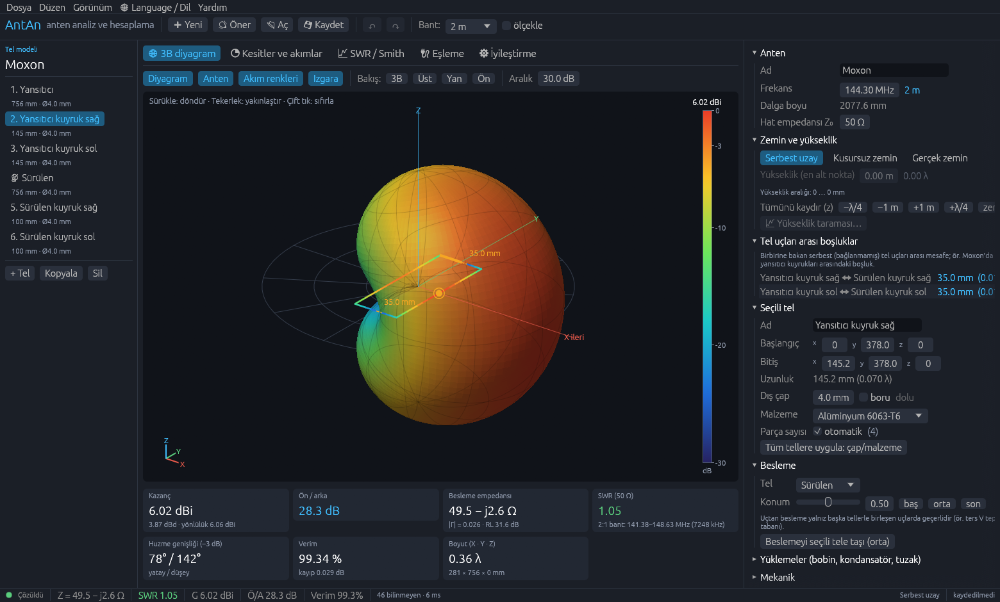

## 11. Yükler: bobin, kondansatör ve tuzak

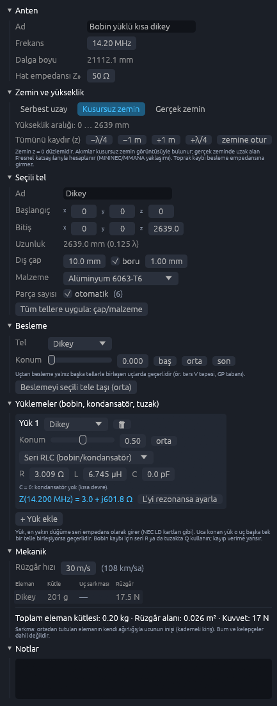

**Yüklemeler (bobin, kondansatör, tuzak)** bölümünde **+ Yük ekle**'ye tıklayın, sonra teli, konumu
ve türü seçin:

- **Seri RLC** — telle seri bobin ve/veya kondansatör (C = 0, kondansatör yok demektir).
- **Paralel RLC**.
- **Tuzak** — L, rezonans frekansı f₀ ve bobin Q değeriyle tanımlanan paralel LC.
- **Sabit R + jX** — frekanstan bağımsız empedans.

Yükün o anki frekanstaki empedansı altında yazar. **L'yi rezonansa ayarla** besleme reaktansını sıfır
yapan bobin değerini bulur — örneğin kısa bir dikeyin yükleme bobini. Yükün aynı telde simetrik bir eşi
varsa (bobinle kısaltılmış dipoldeki gibi) iki bobin birlikte ayarlanır. Direnç (ya da tuzağın Q'su)
bobin kaybıdır ve verimi düşürür.

Yagi'de bölümün adı **Eleman yüklemeleri**'dir: 0 konumundaki yük elemanın ortasına, diğer konumlar
her kola simetrik birer yük olarak yerleşir — kısaltılmış HF Yagi'ler için kullanışlıdır.

## 12. Anten önerileri

**💡 Öner** (araç çubuğu ya da **➕ Yeni → Bir frekans için öneriler…**) bir frekans ya da bant
ister; o frekansa uygun bütün anten türlerini — Yagi'ler, LFA, Moxon, quad, dipoller, halkalar,
dikeyler — kurar, çözer ve kazanç, ön/arka, besleme empedansı, SWR ve en büyük boyutu yan yana
listeler (12 m üstü turuncu, 25 m üstü kırmızı). **Aç** birini yeni tasarım olarak yükler. Beam ve
tel antenler serbest uzayda, dikeyler zeminleriyle karşılaştırılır.

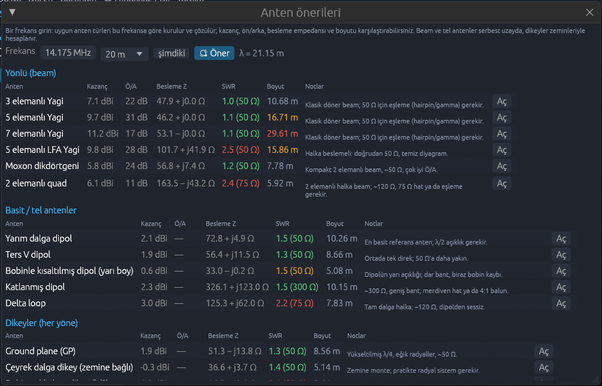

## 13. LFA Yagi (halka beslemeli)

LFA'da (G0KSC tarzı) sürülen eleman, **eleman düzleminde yatan dikdörtgen bir halkadır**; çevresi
yaklaşık bir dalga boyudur ve arka kenarının ortasından beslenir. Eşleme düzeneği olmadan doğrudan
~50 Ω verir. **➕ Yeni → LFA Yagi** halka boyutu bu çözücüyle ayarlanmış 3 … 11 elemanlı tasarımlar
oluşturur. Her Yagi, eleman tablosunun altındaki **LFA sürülen halka** kutusuyla halkaya
çevrilebilir: sürülen elemanın boyu halkanın uzun kenarı olur, **halka genişliği** bum boyunca
ölçülür. Kesim listesi halka kenarlarını verir; halkaya bum düzeltmesi uygulanmaz. Başlangıçtaki
yönlendiriciler standart olanlardır — en iyi ön/arka için İyileştirme sekmesini çalıştırın.

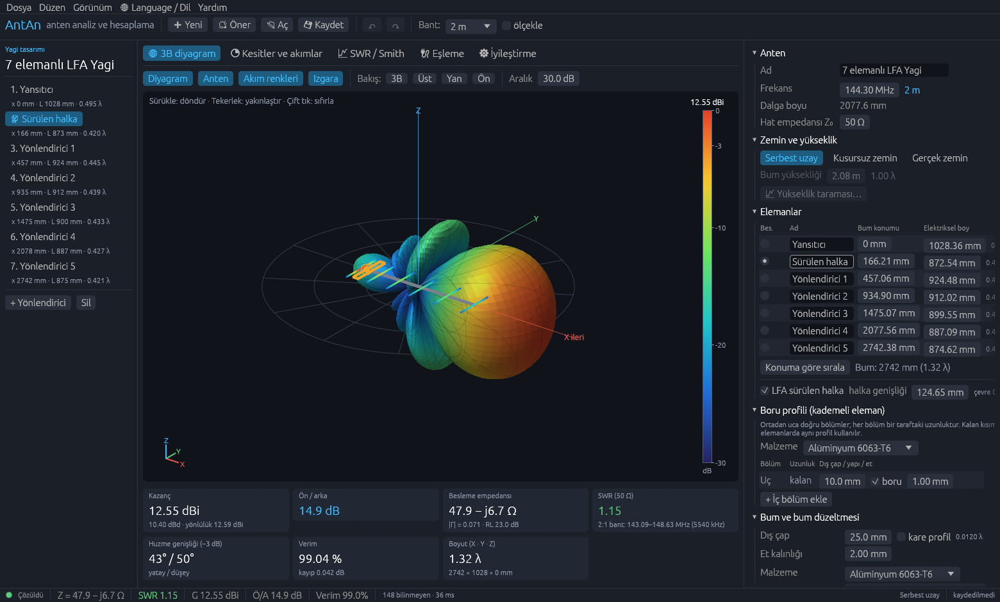

## 14. İstif

**☰ İstif** (araç çubuğu), şu anki antenin iki ya da dört kopyasını yan yana ya da üst üste dizer
ve eşit boylu kablolar ile güç bölücüde olduğu gibi aynı fazda, eşit güçle besler. Antenler arası
karşılıklı etki tahmin edilmez, hesaplanır. Düzenler: 2, 3 ya da 4 anten üst üste, 2 ya da 4 yan
yana ve 2 × 2 (H çerçeve). İstif projeyle kaydedilir ve bütün görünümler istifin tamamını gösterir:

- **Kazanç** kartı istifin tek antene göre kazandırdığını gösterir.
- **İstif** kartı aralıkları ve her antenin kendi besleme empedansını verir. Bu empedanslar
  karşılıklı etki yüzünden biraz farklıdır.
- SWR ve empedans, güç bölücü girişindeki değerlerdir.

Pencere her doğrultu için **DL6WU aralığını** önerir: D = λ / (2·sin(θ/2)). Burada θ, tek antenin
o düzlemdeki −3 dB huzme genişliğidir. Huzme ne kadar darsa aralık o kadar büyür. **▶ Tara**
istifi bir aralık boyunca çözer ve kazancı ile en yüksek yan lobu çizer. Kazancın en
yükseği genellikle DL6WU aralığının biraz ötesindedir. DL6WU'nun değeri, yan lobları daha düşük
tutan iyi bir uzlaşmadır. Bir aralığı kullanmak için grafiğe ya da tablodaki **uygula**'ya tıklayın.

Örnek: iki adet 5 elemanlı 2 m Yagi 1,25 λ'da +3,15 dB, dört tanesi (2 × 2) +6,2 dB kazandırır.

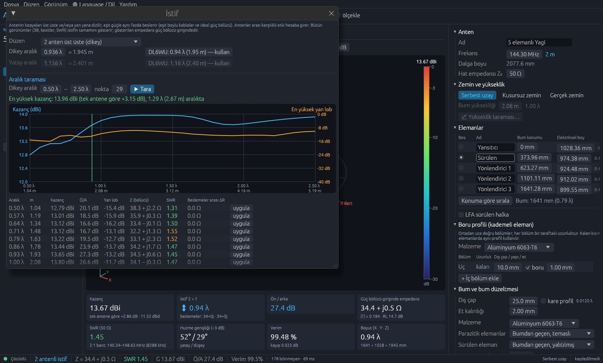

Notlar: bum, direk ve kablolar modellenmez, güç bölücü idealdir. Zemin üzerinde en alttaki anten
ayarladığınız yükseklikte kalır, diğerleri onun üstüne dizilir. Uzun UHF Yagi'lerden çok büyük
istifler çözücünün büyüklük sınırına ulaşabilir.

## 15. Manyetik loop

**➕ Yeni → Manyetik loop** küçük bir verici halka oluşturur: çevresi yaklaşık 0,1 λ olan bakır
borudan bir halka (sekizgen, 16 kenar ya da ≈ daire), tepesinde ayar kondansatörü, altında küçük bir
kuplaj halkası. Tasarım 50 Ω'a eşlenmiş ve ayarlanmış olarak gelir. Sağdaki **Manyetik loop**
bölümünden şunlar ayarlanır:

- halka çapı, biçimi ve borusu;
- kuplaj halkasının çapı, ana halkaya açıklığı ve teli;
- kondansatör ve kayıp direnci (ESR): kelebek ya da vakum kondansatör yaklaşık 5–10 mΩ, sürtünmeli
  kontaklı sıradan döner kondansatör 20–100 mΩ;
- verici gücü.

**🎯 Kondansatörü ayarla** kondansatörü en düşük SWR'ye getirir. Frekansı değiştirince bu kendiliğinden
de olur, tıpkı gerçek bir loop'un kondansatörünü çevirmek gibi. **🎯 Kuplaj halkasını eşle** SWR ≈ 1
için kuplaj halkasının çapını ve açıklığını ayarlar. Bilinen "halkanın 1/5'i" kuralıyla SWR çoğu
zaman 2–6 çıkar. En uygun değer genellikle 1/8–1/10 civarındadır.

3B görünümün altındaki kartlar loop için önemli olanı gösterir:

| Kart | Anlamı |
|---|---|
| Ayar kondansatörü | şimdiki değer ve bütün bandı kapsamak için gereken aralık |
| Kondansatör gerilimi | verici gücünde kondansatör üzerindeki tepe gerilim: 100 W'ta bile birkaç kV, kondansatörü buna göre seçin |
| Halka Q'su | ve −3 dB bant genişliği. SWR < 2 bandı 40 m'de yalnız birkaç kHz'dir. |
| Verim | ışıyan güç / giriş gücü (boru ve kondansatör kaybı düşülmüş) |

Q yüksek olduğu için tarama kendiliğinden dardır (±%0,06). Örnek (40 m, 22 mm bakırdan 1,34 m
halka, 10 mΩ kondansatör): 138 pF, 100 W'ta 8,4 kV, Q ≈ 2200, verim %25.

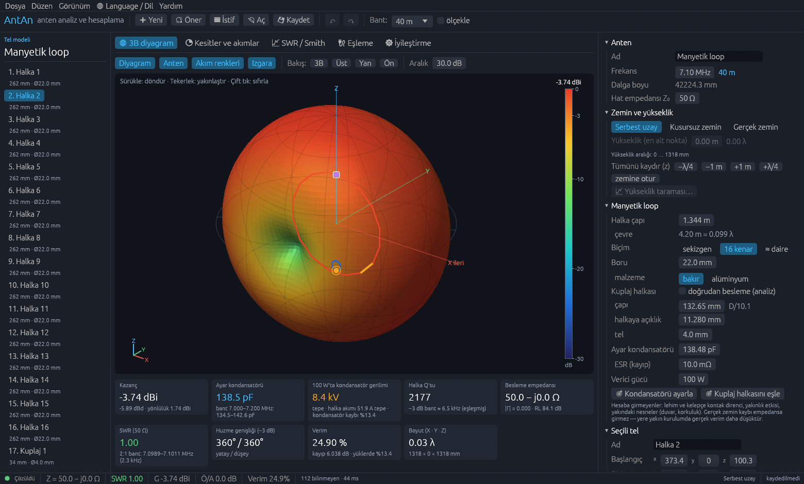

**Doğrudan besleme (analiz)** ana halkanın kendisini besler. Halkanın kendi direncini (onlarca
miliohm) formüllerle karşılaştırmak için gösterir; gerçek besleme için değildir.

Hesaba girmeyenler: lehim ve kelepçe kontak direnci, yakınlık etkisi ve duvar, korkuluk gibi yakındaki
nesneler. Toprak kaybı besleme empedansına girmediği için (8. bölüm) yere yakın kurulan bir loop'un
gerçek verimi gösterilenden düşüktür.

## 16. Dosyalar

- **Dosya → Kaydet / Farklı kaydet** projeyi `.antan` dosyası (okunabilir JSON) olarak saklar.
  **Aç** onu yükler.
- **Dosya → NEC-2 dosyası olarak dışa aktar** 4nec2, xnec2c ya da EZNEC ile karşılaştırmak için NEC
  kart dosyası yazar.
- **Dosya → Pencereyi PNG olarak kaydet** program penceresinin resmini kaydeder.

## 17. Klavye kısayolları

| Tuşlar | İşlem |
|---|---|
| Ctrl+O | Aç |
| Ctrl+S | Kaydet |
| Ctrl+Z | Geri al |
| Ctrl+Y | Yinele |
| Fareyle sürükleme (3B) | Döndür |
| Fare tekerleği (3B) | Yakınlaştır |
| Çift tık (3B) | Görünümü sıfırla |

## 18. Sorun giderme

| Mesaj ya da belirti | Nedeni ve çözümü |
|---|---|
| Pencerenin ortasında "Çözüm yok" | Nedeni durum çubuğunda yazar. En sık görülenler aşağıda. |
| *… kaynak geçerli bir noktada değil* | Besleme serbest bir tel ucunda. Ortaya (0.5) ya da başka bir telle veya zeminle birleşen bir uca taşıyın. |
| *… tel zeminin (z = 0) altına iniyor* | Zemin açıkken bütün teller z ≥ 0'da olmalıdır. Anteni yükseltin (Tümünü kaydır / Bum yüksekliği). |
| *… yük geçerli bir noktada değil* | Yük bir telin içinde ya da tam iki telin birleştiği noktada olmalıdır. |
| *Model bu frekansta elektriksel olarak çok büyük* | Frekans, geometrinin yapıldığı frekansın çok üstünde. Düşürün ya da frekans alanının altındaki **Anteni bu frekansa ölçekle** düğmesini kullanın. |
| SWR yüksek | Eşleme sekmesinde **🎯 Z₀'a eşle**'yi deneyin ya da iyileştiricide SWR'ye yüksek ağırlık verin. UHF'de aşağıdaki uyarıya da bakın. |
| ⚠ *… bu frekans için çok kalın* / *ince tel sınırı* | Eleman çapı 0,02 λ'dan büyük (ör. 23 cm'de 10 mm boru). AntAn da NEC gibi ince tel modeli kullanır; bu kadar kalın iletkenlerde güvenilir değildir — özellikle SWR çok yanlış çıkabilir. Daha ince boru ya da çubuk kullanın (23 cm'de genelde 3–4 mm). 0,1 λ'nın üstünde model hiç çözülmez. |
| ⚠ *parçalar tel yarıçapının yalnız … katı* | Kalın bir tele elle çok fazla parça verilmiş. *Otomatik* ya da daha az parça seçin. |
| "L'yi rezonansa ayarla" sonuç vermiyor | Daha küçük bir endüktanstan başlayın; çok büyük bobinler ötesindeki tel parçasıyla rezonansa girebilir. |
| Sonuçlar NEC'ten biraz farklı | Beklenen bir durum; 19. bölüme ve [karşılaştırma raporuna](dogrulama.md) bakın. |
| Manyetik loop: *kondansatörle ayarlanamaz* | Halka bu frekans için çok büyük (kendi rezonansının üstünde). Daha küçük çap kullanın. |

## 19. Doğruluk ve sınırlar

AntAn, bilinen sonuçlarla sınanmış bir ince tel moment yöntemi çözücüsü kullanır: yarım dalga dipol
(≈ 73 + j42 Ω, 2.15 dBi), enerji korunumu, zemin üzerinde görüntü teorisi ve daha fazlası. Tam liste
[README](../README.tr.md) dosyasındadır.

- AntAn, NEC-2 ve MININEC çekirdekleriyle tek tek karşılaştırıldı: bkz.
  [karşılaştırma raporu](dogrulama.md). Kısaca: kazanç NEC-2 ile birkaç onda bir dB, MININEC
  (MMANA-GAL) ile 0,01 dB içinde uyuşur. Borudan yapılmış antenlerde AntAn rezonans frekansını
  NEC-2'den yaklaşık %1 yüksek bulur; bu, MMANA ile EZNEC arasındaki bilinen farktır. Budama
  payı bırakın.
- Gerçek zeminde toprak kaybı besleme empedansına girmez (8. bölüm).
- Gamma eşleme modeli yaklaşıktır.
- Her ince tel programında olduğu gibi çok kalın teller, çok kısa parçalar ve birbirine çok yaklaşan
  teller doğruluğu düşürür.
