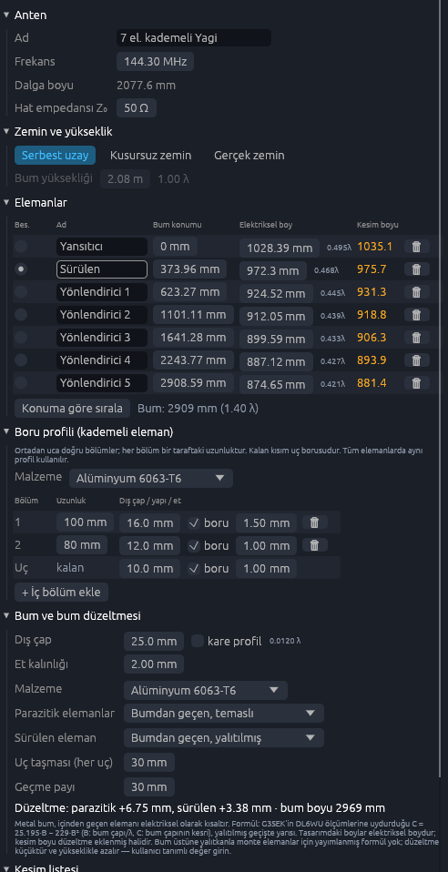
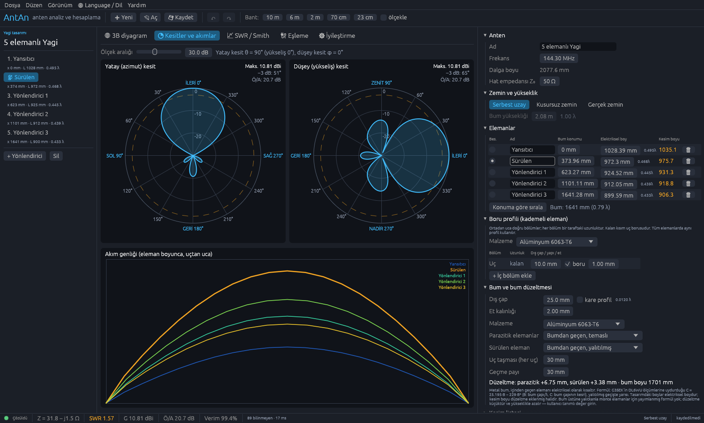
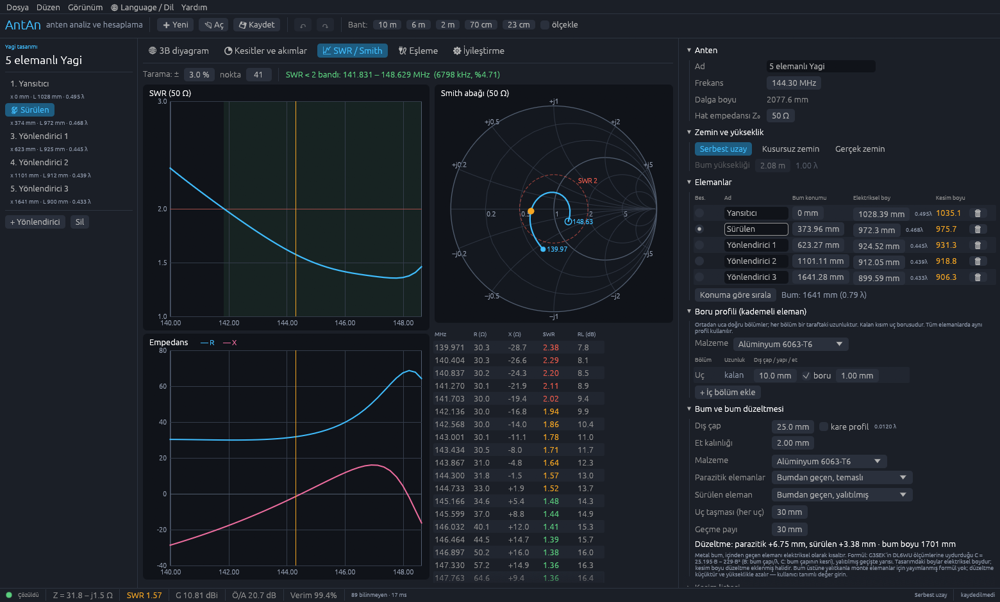
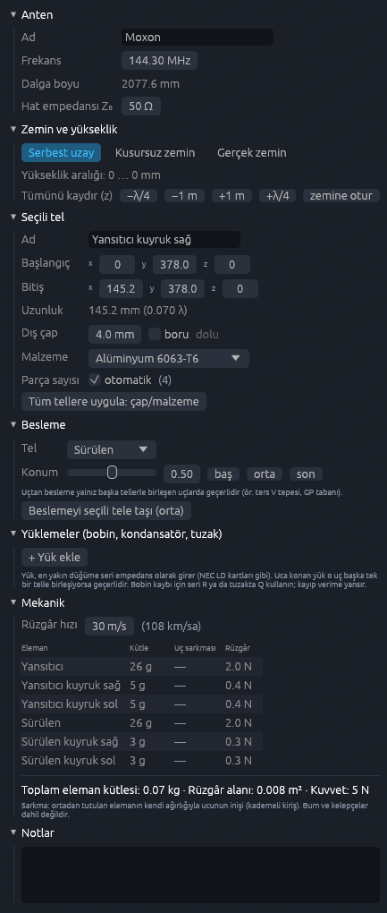

<p align="center"></p>

# AntAn kullanma kılavuzu

[English](user-guide.md) · **Türkçe**

AntAn bir anten analiz ve tasarım programıdır. Bir anteni tarif edersiniz: Yagi'yi elemanları ve
borularıyla, herhangi bir anteni de teller kümesi olarak. AntAn empedansını, SWR'sini, kazancını,
ışıma diyagramını, eşleme devrelerini ve kesilecek boru boylarını hesaplar. Bu kılavuz programı
önce adım adım bir örnekle, sonra her özelliği ayrı ayrı anlatır.

## İçindekiler

1. [Kurulum](#1-kurulum)
2. [Ekran](#2-ekran)
3. [Önce bilinmesi gerekenler](#3-önce-bilinmesi-gerekenler)
4. [Uygulama: 2 m için 5 elemanlı Yagi](#4-uygulama-2-m-için-5-elemanlı-yagi)
5. [Sonuçları okumak](#5-sonuçları-okumak)
6. [Eşleme](#6-eşleme)
7. [İyileştirme](#7-iyileştirme)
8. [Zemin ve yükseklik](#8-zemin-ve-yükseklik)
9. [Tasarımdan atölyeye: bum düzeltmesi ve kesim listesi](#9-tasarımdan-atölyeye-bum-düzeltmesi-ve-kesim-listesi)
10. [Tel modelleri: her tür anten](#10-tel-modelleri-her-tür-anten)
11. [Yükler: bobin, kondansatör ve tuzak](#11-yükler-bobin-kondansatör-ve-tuzak)
12. [Dosyalar](#12-dosyalar)
13. [Klavye kısayolları](#13-klavye-kısayolları)
14. [Sorun giderme](#14-sorun-giderme)
15. [Doğruluk ve sınırlar](#15-doğruluk-ve-sınırlar)

## 1. Kurulum

**Windows (hazır program)**

1. [Sürümler sayfasını](https://github.com/sozden/AntAn/releases) açın ve
   `AntAn-<sürüm>-windows-x64.zip` dosyasını indirin.
2. Zip'i istediğiniz yere (örneğin Masaüstü) açın ve `AntAn.exe`'ye çift tıklayın. Kurulum gerekmez.
3. Program dijital olarak imzalı olmadığı için Windows SmartScreen ilk açılışta uyarı verebilir:
   **Ek bilgi → Yine de çalıştır**'a tıklayın.

**Kaynak koddan (Rust kurulu her sistemde)**

```
git clone https://github.com/sozden/AntAn
cd AntAn
cargo run --release -p antan
```

**Dil.** Arayüz İngilizce açılır. **🌐 Language / Dil** menüsünden Türkçe'yi seçin; seçim hatırlanır.

## 2. Ekran


| No | Bölüm | Ne işe yarar |
|---|---|---|
| 1 | Menü çubuğu | Dosya, Düzen, Görünüm, Language / Dil, Yardım |
| 2 | Araç çubuğu | Yeni, Aç, Kaydet, geri al/yinele, **bant düğmeleri** (10 m … 23 cm) ve **ölçekle** seçeneği |
| 3 | Model listesi | Elemanlar (Yagi) ya da teller (tel modeli). Birine tıklayınca 3B'de turuncu yanar, ayarları sağda açılır |
| 4 | Sekmeler | 3B diyagram, Kesitler ve akımlar, SWR / Smith, Eşleme, İyileştirme |
| 5 | Görünüm alanı | Seçili sekmenin içeriği |
| 6 | Sonuç kartları | Kazanç, ön/arka, besleme empedansı, SWR ve 2:1 bant, huzme genişliği, verim ve boyut |
| 7 | Özellikler | Antenin bütün ayarları, açılır kapanır bölümler halinde |
| 8 | Durum çubuğu | Empedans, SWR, kazanç, Ö/A, verim, çözüm süresi; hata mesajları burada çıkar |

## 3. Önce bilinmesi gerekenler

- **"Hesapla" düğmesi yoktur.** Her değişiklik anında çözülür. Frekans taraması arka planda, bütün
  işlemci çekirdeklerinde çalışır; bu sırada dönen bir gösterge görünür.
- **Geri al** Ctrl+Z, **yinele** Ctrl+Y. Büyük işlemler (şablon yükleme, iyileştirme sonucunu
  uygulama) her zaman geri alınabilir.
- **Birimler:** arayüzde uzunluklar milimetre, frekanslar MHz'dir. Birçok alanda değerin dalga boyu
  (λ) karşılığı da yazar.
- **Sayı girmek:** sayı alanını fareyle sağa sola sürükleyin ya da çift tıklayıp yazın.
- **Eksenler:** +X ileri (bum boyunca, Yagi'nin ışıdığı yön), Y eleman ekseni, +Z yukarı. Zemin
  kullanılıyorsa z = 0 düzlemidir.

## 4. Uygulama: 2 m için 5 elemanlı Yagi

### 4.1 Tasarımı başlatın

**➕ Yeni → 5 elemanlı Yagi**'yi seçin. AntAn genel geçer ölçülerle bir başlangıç tasarımı kurar.
Bu bir taslaktır; sonraki adımlarda kendi bandınıza ve borularınıza göre uyarlayacaksınız.

### 4.2 Frekans ve besleme hattı

Sağ paneldeki **Anten** bölümünde:

- **Frekans:** 144.300 MHz (ya da **2 m** bant düğmesine tıklayın).
- **Hat empedansı Z₀:** kullandığınız koaksiyel, genelde 50 Ω. SWR bu değere göre hesaplanır.

> **İpucu:** bant düğmelerinin yanındaki **ölçekle** kutusu bant düğmesinin ne yapacağını belirler.
> İşaretsizse yalnız analiz frekansı değişir. İşaretliyse anten yeni dalga boyuna göre baştan
> ölçeklenir — 2 m tasarımını 70 cm'ye çevirmek için kullanışlıdır.

### 4.3 Borular



**Boru profili (kademeli eleman)** bölümünde:

- **Malzeme**'yi seçin (ör. Alüminyum 6063-T6).
- **Uç** satırı elemanlarda kullanılan borudur: dış çap (ör. 10 mm). **boru** işaretliyse et
  kalınlığını girin (ör. 1 mm); işaretsizse içi dolu çubuk sayılır.
- **Teleskopik (kademeli) elemanlar** için (ortası kalın, uçlara doğru incelen) **+ İç bölüm ekle**'ye
  tıklayın. Her satır ortadan dışa doğru bir bölümdür; uzunluğu tek taraftakidir. Örnek: 100 mm Ø16,
  sonra 80 mm Ø12, geri kalanı Ø10. Bütün elemanlar aynı profili kullanır.

Çap, et kalınlığı ve malzeme hesaba girer (iletken kaybı ve deri etkisi).

### 4.4 Eleman konumları ve boyları

**Elemanlar** tablosunda her eleman bir satırdır:

- **Bes.** sürülen (beslenen) elemanı işaretler.
- **Bum konumu** — yansıtıcı genelde 0 mm, diğerleri onun önünde.
- **Elektriksel boy** — çözücünün kullandığı uçtan uca boy. Yanında λ karşılığı yazar.
- **Kesim boyu** — salt okunur; bum düzeltmesi eklenmiş, gerçekte keseceğiniz boy (9. bölüm).

Eleman eklemek ve silmek için model listesinin altındaki **+ Yönlendirici / Sil** düğmelerini ya da
tablodaki 🗑'yi kullanın. **Konuma göre sırala** listeyi düzenler.

### 4.5 Sonuca bakın

**🌐 3B diyagram** sekmesini açın. Renkli yüzey ışıma diyagramıdır (kırmızı en güçlü yön, mavi
zayıf). Ortada anten, akımlarına göre renkli olarak çizilir; turuncu halka besleme noktasıdır.
Sürükleyerek döndürün, tekerlekle yakınlaşın, çift tıklayarak sıfırlayın; **Bakış** düğmeleri 3B /
üst / yan / ön görünümleri verir.

Sağdaki kartlar (2. bölümdeki 6 numara) tasarımı özetler: dBi ve dBd cinsinden kazanç, ön/arka oranı,
besleme empedansı, SWR (yeşil iyi, sarı orta, kırmızı kötü) ve 2:1 bant genişliği, huzme genişliği,
verim ve boyut.

## 5. Sonuçları okumak

### Kesitler ve akımlar



- **Yatay (azimut) kesit** — diyagramın yukarıdan görünüşü. İLERİ yukarıdadır.
- **Düşey (yükseliş) kesit** — yandan görünüş. Zemin varken kalkış açısını gösterir.
- Kesikli halka −3 dB'dir; sağ üstte en yüksek kazanç, −3 dB huzme genişliği ve Ö/A yazar.
  Fareyi grafiğin üzerinde gezdirince her açıdaki kazancı okursunuz.
- **Akım genliği** her eleman boyunca (uçtan uca). Seçili eleman turuncu çizilir.

### SWR, empedans ve Smith abağı



- Üstte tarama aralığını (merkez frekansın ± %'si) ve nokta sayısını ayarlayın.
- **SWR grafiğinde** SWR < 2 olan bant yeşil gölgelidir; sınırları en üstte yazar.
- **Empedans grafiği** R (mavi) ve X (pembe) değerlerini gösterir.
- **Smith abağı** tarama boyunca empedansın izlediği yolu gösterir; kesikli çember SWR 2, sarı nokta
  tasarım frekansıdır.
- Herhangi bir grafiğin üzerinde gezinince frekans, empedans ve SWR görünür. Tabloda değerler listelenir.

## 6. Eşleme


Besleme empedansı Z₀'a eşit değilse **🔌 Eşleme** sekmesi üç çözüm sunar:

- **L devresi** — olası her düzen için bobin ve kondansatör değerleri (nH, pF), sonuç empedansının
  kontrolüyle birlikte.
- **Hairpin (beta) eşleme** — çubuk çapını ve aralığını girin; hairpin boyunu ve endüktansını
  verir. Hairpin için sürülen eleman biraz *kısa* (kapasitif) olmalıdır; kart elemanı kısaltmanız mı
  uzatmanız mı gerektiğini söyler.
- **Gamma eşleme** — gamma çubuğu boyu, seri kondansatör ve yükseltme oranı (yaklaşık bir model;
  rezonanstaki elemanla en iyi sonuç verir).

**Sürülen elemanı otomatik ayarla**, sürülen eleman boyunu gerçek çözücüyle değiştirir:
*Rezonansa getir* (X = 0, gamma ya da doğrudan besleme için) veya *Hairpin için kapasitif yap*.
Sonuç tasarıma uygulanır ve geri alınabilir.

## 7. İyileştirme


**⚙ İyileştirme** sekmesi bir Yagi'yi otomatik olarak ayarlar.

1. **Hedefleri** belirleyin: kazanç, ön/arka ve SWR ağırlıkları. Ağırlık büyüdükçe "bu daha önemli"
   demektir. *Ön/arka tavanı*, Ö/A belli bir değerin (ör. 25 dB) üstüne çıkınca artık ödül vermez;
   böylece iyileştirici birkaç dB fazla Ö/A için kazançtan vazgeçmez.
2. **Bant (±)** — 0 yalnız merkez frekansta iyileştirir; örneğin %1 bant kenarlarını da değerlendirir.
3. **Kısıtlar** — eleman konumlarının değişmesine izin verin ya da sabitleyin; *Bum boyunu koru*
   ilk ve son elemanı yerinde tutar.
4. **▶ Başlat**'a tıklayın. Grafik şimdiye kadarki en iyi maliyeti (yukarı daha iyi), tablo her
   elemanın boy değişimini gösterir.
5. Memnunsanız **✔ Sonucu tasarıma uygula**; Ctrl+Z eski tasarımı geri getirir.

İyileştirici her adımda gerçek çözücüyü kullanır; küçük bir Yagi'de birkaç yüz adım birkaç saniye sürer.

## 8. Zemin ve yükseklik


**Zemin ve yükseklik** bölümünde:

- **Serbest uzay** — zemin yok (antenleri tek başına karşılaştırmak için).
- **Kusursuz zemin** — ideal iletken zemin.
- **Gerçek zemin** — **Hazır** listesinden toprak türünü seçin (deniz suyu, ortalama toprak, kayalık
  toprak …) ya da dielektrik sabiti εr ve iletkenlik σ değerlerini girin.
- Yagi'de **Bum yüksekliği**'ni girin. Tel modellerinde koordinatlar mutlak yüksekliktir;
  **Tümünü kaydır (z)** ya da **zemine otur** düğmelerini kullanın.

Zemin varken **Kalkış açısı** kartı çıkar: en güçlü ışımanın yükseliş açısı. Anten yükseldikçe açı
düşer (DX için daha iyi). Yatay kesit de bu durumda kalkış açısında alınır.

> Gerçek zeminde AntAn, MININEC/MMANA ile aynı yaklaşımı kullanır: akımlar kusursuz zemin üzerinde
> çözülür, uzak alanda toprağın yansıması hesaba katılır. Bu yüzden toprak kaybı besleme empedansına
> girmez; bu en çok yere yakın dikey antenlerde önemlidir.

## 9. Tasarımdan atölyeye: bum düzeltmesi ve kesim listesi

### Bum düzeltmesi

İçinden geçtiği metal bum, elemanı elektriksel olarak kısaltır; eleman biraz uzun kesilmelidir.
**Bum ve bum düzeltmesi** bölümünde:

- Bumun **dış çapını** (kare profilde **kare profil** işaretleyip kenarını), et kalınlığını ve
  malzemesini girin.
- **Parazitik elemanların** ve **sürülen elemanın** nasıl bağlandığını seçin:
  *bumdan geçen, temaslı*; *bumdan geçen, yalıtılmış* (düzeltmenin yarısı); *düzeltme yok* (yalıtkan
  bum ya da bumdan uzak elemanlar) veya *kullanıcı tanımlı* — örneğin bumun üstüne yalıtkanla monte
  elemanlar için; bunun için yayımlanmış bir formül yoktur.
- Düzeltme (DL6WU/G3SEK formülü) altta ve eleman tablosundaki **Kesim boyu** sütununda görünür.
- *Uç taşması* bumun uç elemanlardan dışarı taşan kısmıdır; *Geçme payı* bir borunun diğerinin içine
  ne kadar girdiğidir.

### Kesim listesi


**Kesim listesi** her elemanın her boru parçasını verir: adet, kesim boyu ve çap × et — geçme payı ve
bum düzeltmesi dahil. Altında boru ölçüsüne göre toplam ihtiyaç (fire hariç) yazar.
**📋 Kesim listesini panoya kopyala** listeyi herhangi bir metin düzenleyiciye yapıştırılabilir hale getirir.

### Mekanik

**Mekanik** bölümü her elemanın ve bumun kütlesini, ortadan tutulan her elemanın kendi ağırlığıyla
uç sarkmasını ve girdiğiniz hızdaki rüzgâr yükünü gösterir.

## 10. Tel modelleri: her tür anten



Eleman bazlı Yagi olmayan her şey bir **tel modelidir**.

1. **➕ Yeni → Tel modelleri** hazır antenler sunar: dipol, ters V, katlanmış dipol, 2 elemanlı quad,
   delta loop, ground plane, Moxon, zemine bağlı dikey, tuzaklı dipol, bobin yüklü dikey.
   **Düzen → Tel modeline dönüştür** bir Yagi'yi de tellere çevirir.
2. Model listesinden bir tel seçin. **Seçili tel** bölümünde başlangıç ve bitiş koordinatlarını (mm),
   dış çapı, boru/dolu seçimini, malzemeyi ve parça sayısını girin (*otomatik* neredeyse her zaman
   yeterlidir).
3. **Telleri birleştirmek:** iki telin ucunu tam olarak aynı koordinata getirin; AntAn onları
   otomatik bağlar (köşe, T bağlantı, radyaller). Ayrı bir "bağla" komutu yoktur.
4. Model listesinin altındaki **+ Tel / Kopyala / Sil** tel ekler ve siler.
5. **Besleme:** teli ve tel üzerindeki konumu seçin (0 baş, 0.5 orta, 1 son). Uçtan besleme yalnızca
   o uç başka bir telle ya da zeminle birleşiyorsa çalışır — örneğin ters V'nin tepesi ya da dikeyin
   tabanı.

## 11. Yükler: bobin, kondansatör ve tuzak


**Yüklemeler (bobin, kondansatör, tuzak)** bölümünde **+ Yük ekle**'ye tıklayın, sonra teli, konumu
ve türü seçin:

- **Seri RLC** — telle seri bobin ve/veya kondansatör (C = 0, kondansatör yok demektir).
- **Paralel RLC**.
- **Tuzak** — L, rezonans frekansı f₀ ve bobin Q değeriyle tanımlanan paralel LC.
- **Sabit R + jX** — frekanstan bağımsız empedans.

Yükün o anki frekanstaki empedansı altında yazar. **L'yi rezonansa ayarla** besleme reaktansını sıfır
yapan bobin değerini bulur — örneğin kısa bir dikeyin yükleme bobini. Direnç (ya da tuzağın Q'su)
bobin kaybıdır ve verimi düşürür.

Yagi'de bölümün adı **Eleman yüklemeleri**'dir: 0 konumundaki yük elemanın ortasına, diğer konumlar
her kola simetrik birer yük olarak yerleşir — kısaltılmış HF Yagi'ler için kullanışlıdır.

## 12. Dosyalar

- **Dosya → Kaydet / Farklı kaydet** projeyi `.antan` dosyası (okunabilir JSON) olarak saklar.
  **Aç** onu yükler.
- **Dosya → NEC-2 dosyası olarak dışa aktar** 4nec2, xnec2c ya da EZNEC ile karşılaştırmak için NEC
  kart dosyası yazar.
- **Dosya → Pencereyi PNG olarak kaydet** program penceresinin resmini kaydeder.

## 13. Klavye kısayolları

| Tuşlar | İşlem |
|---|---|
| Ctrl+O | Aç |
| Ctrl+S | Kaydet |
| Ctrl+Z | Geri al |
| Ctrl+Y | Yinele |
| Fareyle sürükleme (3B) | Döndür |
| Fare tekerleği (3B) | Yakınlaştır |
| Çift tık (3B) | Görünümü sıfırla |

## 14. Sorun giderme

| Mesaj ya da belirti | Nedeni ve çözümü |
|---|---|
| Pencerenin ortasında "Çözüm yok" | Nedeni durum çubuğunda yazar. En sık görülenler aşağıda. |
| *… kaynak geçerli bir noktada değil* | Besleme serbest bir tel ucunda. Ortaya (0.5) ya da başka bir telle veya zeminle birleşen bir uca taşıyın. |
| *… tel zeminin (z = 0) altına iniyor* | Zemin açıkken bütün teller z ≥ 0'da olmalıdır. Anteni yükseltin (Tümünü kaydır / Bum yüksekliği). |
| *… yük geçerli bir noktada değil* | Yük bir telin içinde ya da tam iki telin birleştiği noktada olmalıdır. |
| SWR yüksek | Eşleme sekmesini kullanın ya da iyileştiricide SWR'yi hedeflere katın. |
| "L'yi rezonansa ayarla" sonuç vermiyor | Daha küçük bir endüktanstan başlayın; çok büyük bobinler ötesindeki tel parçasıyla rezonansa girebilir. |
| Sonuçlar NEC'ten biraz farklı | Normaldir; programlar arasında birkaç yüzdelik fark beklenir. |

## 15. Doğruluk ve sınırlar

AntAn, bilinen sonuçlarla sınanmış bir ince tel moment yöntemi çözücüsü kullanır: yarım dalga dipol
(≈ 73 + j42 Ω, 2.15 dBi), enerji korunumu, zemin üzerinde görüntü teorisi ve daha fazlası. Tam liste
[README](../README.tr.md) dosyasındadır.

- NEC ile birkaç yüzdelik farklar normaldir.
- Gerçek zeminde toprak kaybı besleme empedansına girmez (8. bölüm).
- Gamma eşleme modeli yaklaşıktır.
- Her ince tel programında olduğu gibi çok kalın teller, çok kısa parçalar ve birbirine çok yaklaşan
  teller doğruluğu düşürür.
