<p align="center"></p>

# AntAn user guide

**English** · [Türkçe](kullanim-kilavuzu.md)

AntAn is an antenna analysis and design program. You describe an antenna — a Yagi by its elements
and tubes, or any antenna as a set of wires — and AntAn computes its impedance, SWR, gain, radiation
pattern, matching networks and the exact tube lengths to cut. This guide walks through the program
with a worked example and then covers each feature.

## Contents

1. [Installation](#1-installation)
2. [The screen](#2-the-screen)
3. [Basics worth knowing first](#3-basics-worth-knowing-first)
4. [Tutorial: a 5-element Yagi for 2 m](#4-tutorial-a-5-element-yagi-for-2-m)
5. [Reading the results](#5-reading-the-results)
6. [Matching](#6-matching)
7. [Optimization](#7-optimization)
8. [Ground and height](#8-ground-and-height)
9. [From design to workshop: boom correction and cut list](#9-from-design-to-workshop-boom-correction-and-cut-list)
10. [Wire models: any antenna](#10-wire-models-any-antenna)
11. [Loads: coils, capacitors and traps](#11-loads-coils-capacitors-and-traps)
12. [Antenna suggestions](#12-antenna-suggestions)
13. [LFA Yagi (loop fed array)](#13-lfa-yagi-loop-fed-array)
14. [Files](#14-files)
15. [Keyboard shortcuts](#15-keyboard-shortcuts)
16. [Troubleshooting](#16-troubleshooting)
17. [Accuracy and limitations](#17-accuracy-and-limitations)

## 1. Installation

**Windows (ready-made program)**

1. Open the [Releases page](https://github.com/sozden/AntAn/releases) and download
   `AntAn-<version>-windows-x64.zip` (64-bit Windows, almost every PC) or
   `AntAn-<version>-windows-x86.zip` (32-bit Windows).
2. Extract the zip anywhere (e.g. your Desktop) and double-click `AntAn.exe`. No installation is needed.
3. The program is not code-signed, so Windows SmartScreen may show a warning the first time:
   click **More info → Run anyway**.

**Linux (ready-made program, x86-64)**

1. Download `AntAn-<version>-linux-x64.tar.gz` from the Releases page.
2. Extract and run:
   ```
   tar xzf AntAn-<version>-linux-x64.tar.gz
   cd AntAn-<version>-linux-x64
   ./antan
   ```
3. Requires glibc 2.35 or newer (Ubuntu 22.04+, Debian 12+, Fedora 36+, Linux Mint 21+) and a
   desktop with X11 or Wayland and OpenGL. File dialogs use the desktop portal
   (`xdg-desktop-portal`), which normal desktops already have. `install-desktop.sh` adds AntAn to
   the application menu with its icon (optional, for the current user only).

**From source (any platform with Rust)**

```
git clone https://github.com/sozden/AntAn
cd AntAn
cargo run --release -p antan
```

**Language.** The interface starts in English. Use the **🌐 Language / Dil** menu to switch to
Turkish; the choice is remembered.

**Text size.** On a small or high-resolution screen use **View → Text size** (85 % … 200 %) or
**Ctrl +** / **Ctrl −** (**Ctrl 0** resets). The whole interface scales and the setting is remembered;
side panels shrink with the window and wide tables scroll sideways.

## 2. The screen

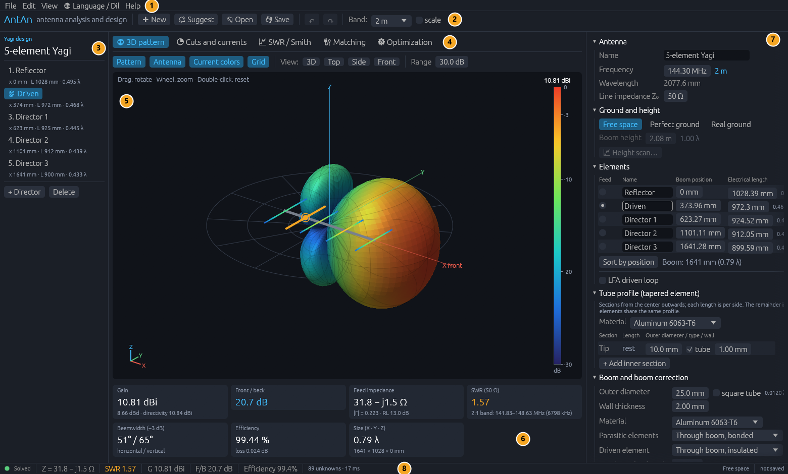

| # | Area | What it does |
|---|---|---|
| 1 | Menu bar | File, Edit, View, Language / Dil, Help |
| 2 | Toolbar | New, **💡 Suggest**, Open, Save, undo/redo, the **Band** menu (160 m … 13 cm) and the **scale** option |
| 3 | Model tree | The elements (Yagi) or wires (wire model). Click one to select it — it turns orange in 3D and its settings open on the right |
| 4 | Tabs | 3D pattern, Cuts and currents, SWR / Smith, Matching, Optimization |
| 5 | View area | The content of the selected tab |
| 6 | Result cards | Under the 3D pattern, side by side: gain, front/back, (takeoff angle), feed impedance, SWR and 2:1 bandwidth, beamwidth, efficiency, size |
| 7 | Properties | All settings of the antenna, in collapsible sections |
| 8 | Status bar | Impedance, SWR, gain, F/B, efficiency, solver time; error messages appear here |

## 3. Basics worth knowing first

- **There is no "Calculate" button.** Every change is solved immediately. The frequency sweep runs in
  the background on all processor cores; a spinner shows while it works.
- **Undo** with Ctrl+Z, **redo** with Ctrl+Y. Big actions (loading a template, applying an
  optimization) can always be undone.
- **Units:** lengths in the interface are in millimetres; frequencies in MHz. Many fields also show
  the value in wavelengths (λ).
- **Editing numbers:** drag a number field left/right with the mouse, or double-click it and type.
- **Axes:** +X is forward (along the boom, the direction a Yagi beams), Y is along the elements,
  +Z is up. The ground, when used, is the plane z = 0.

## 4. Tutorial: a 5-element Yagi for 2 m

### 4.1 Start a design

Choose **➕ New → 5-element Yagi**. AntAn creates a starting design with typical dimensions. It is a
draft — the next steps adapt it to your band and your tubes.

### 4.2 Frequency and feed line

In **Antenna** (right panel) set:

- **Frequency:** 144.300 MHz (or pick **2 m** from the **Band** menu). The field accepts 0.1 … 3000 MHz
  and shows which amateur band the frequency is in.
- **Line impedance Z₀:** your coax, usually 50 Ω. SWR is calculated against this value.

> **Tip:** the **scale** checkbox next to the Band menu decides what choosing a band does. Unchecked:
> only the analysis frequency changes. Checked: the whole antenna is rescaled to the new wavelength —
> handy for turning a 2 m design into a 70 cm one. If the frequency ends up far from the one the
> geometry was made for, a warning appears under the frequency with a **Scale the antenna to this
> frequency** button. An antenna that is electrically huge at the chosen frequency is not solved (it
> would need too much memory); the program says so instead of freezing.

### 4.3 Tubes

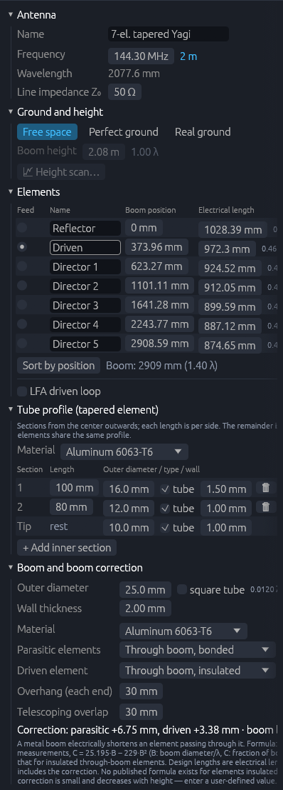

In **Tube profile (tapered element)**:

- Choose the **Material** (e.g. Aluminum 6063-T6).
- The **Tip** row is the tube used for the elements: outer diameter (e.g. 10 mm). With **tube**
  checked, enter the wall thickness (e.g. 1 mm); unchecked means a solid rod.
- For **telescoping elements** (thick at the center, thinner towards the tips) click
  **+ Add inner section**. Each row is a section from the center outwards; its length is per side.
  Example: 100 mm of Ø16, then 80 mm of Ø12, the rest Ø10. All elements use the same profile.

Diameter, wall thickness and material all enter the calculation (conductor loss and skin effect).

### 4.4 Element positions and lengths

The **Elements** table has one row per element:

- **Feed** marks the driven (fed) element.
- **Boom position** — the reflector is usually at 0 mm, the others forward of it.
- **Electrical length** — tip-to-tip length used by the solver. The value in λ is shown beside it.
- **Cut length** — read-only; the length to actually cut, including the boom correction (section 9).

Add or remove elements with **+ Director / Delete** under the model tree or with 🗑 in the table.
**Sort by position** tidies the list.

### 4.5 Look at the result

Open the **🌐 3D pattern** tab. The colored surface is the radiation pattern (red = strongest
direction, blue = weak). The antenna is drawn in the middle with its currents in color; the orange
ring is the feed point. Drag to rotate, use the wheel to zoom, double-click to reset; the **View**
buttons give 3D / top / side / front views.

The cards under the pattern (area 6 in section 2) summarize the design: gain in dBi and dBd, front-to-back
ratio, feed impedance, SWR (green good, amber fair, red poor) with the 2:1 bandwidth, beamwidth,
efficiency and size.

## 5. Reading the results

### Cuts and currents

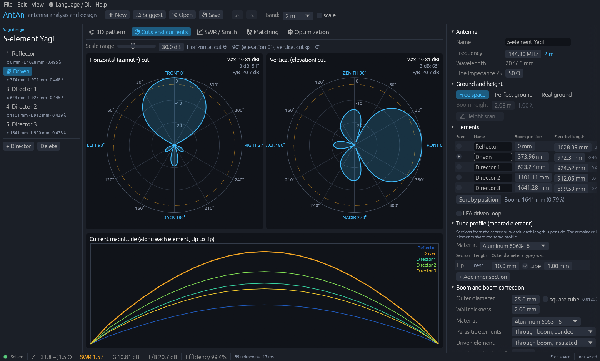

- **Horizontal (azimuth) cut** — the pattern seen from above. FRONT is up.
- **Vertical (elevation) cut** — the pattern seen from the side. Over ground this shows the
  takeoff angle.
- The dashed ring is −3 dB; the numbers at the top right give maximum gain, −3 dB beamwidth and F/B.
  Hover the plot to read the gain at any angle.
- **Current magnitude** along each element (tip to tip). The selected element is drawn in orange.

### SWR, impedance and Smith chart

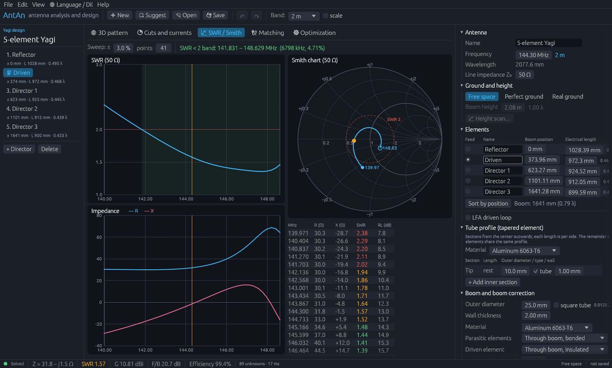

- Set the sweep range (± % of the center frequency) and the number of points at the top.
- The **SWR plot** shades the SWR < 2 band in green; its limits are written at the top.
- The **impedance plot** shows R (blue) and X (pink).
- The **Smith chart** shows the impedance path over the sweep; the dashed circle is SWR 2, the amber
  dot is the design frequency.
- Hover any plot for frequency, impedance and SWR. The table lists the values.

## 6. Matching

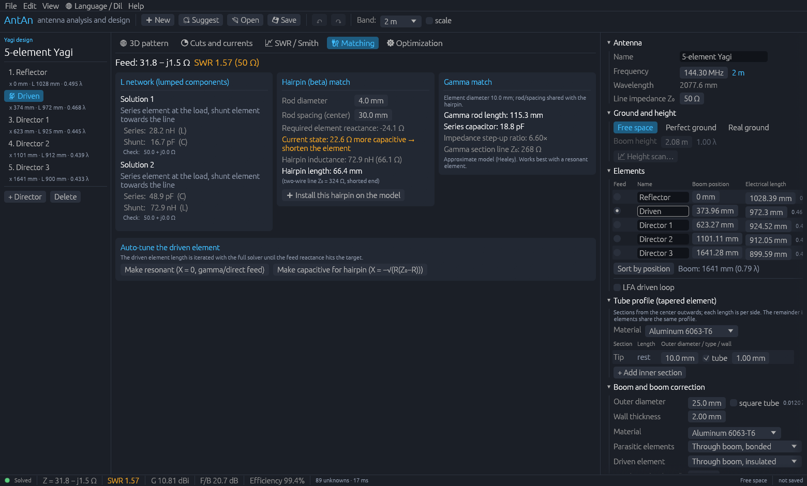

When the feed impedance is not equal to Z₀, the **🔌 Matching** tab offers three solutions:

- **L network** — coil and capacitor values (nH, pF) for every possible arrangement, with a check of
  the resulting impedance.
- **Hairpin (beta) match** — enter the rod diameter and spacing; you get the hairpin length and
  inductance. A hairpin needs the driven element slightly *short* (capacitive); the card tells you
  whether to shorten or lengthen it.
- **Gamma match** — gamma rod length, series capacitor and step-up ratio (an approximate model;
  best with a resonant element).

**➕ Install this hairpin on the model** (in the hairpin card) puts the calculated hairpin across the
feed point. From then on the feed impedance, SWR, the result cards and the whole sweep/Smith chart
are shown on the line side, with the hairpin included (its reactance changes with frequency). The
installed value can be edited or removed in the green bar. Combine it with *Make capacitive for
hairpin* below to see the final matched SWR curve.

**Auto-tune the driven element** changes the driven element length with the full solver:
*Make resonant* (X = 0, for gamma or direct feed) or *Make capacitive for hairpin*. The result is
applied to the design and can be undone.

## 7. Optimization

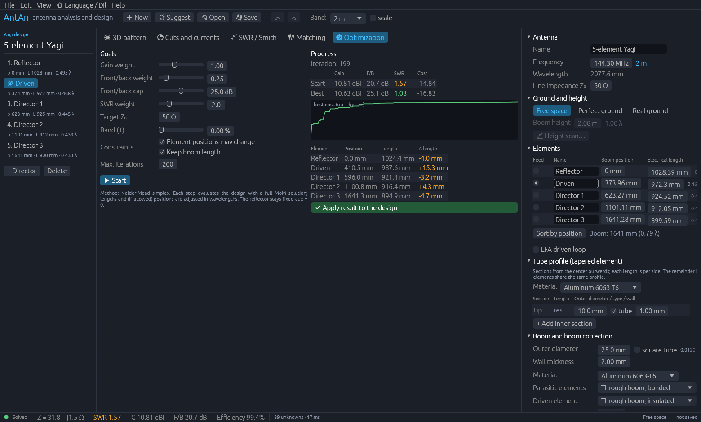

The **⚙ Optimization** tab tunes a Yagi automatically.

1. Set the **goals**: weights for gain, front/back and SWR. A larger weight means "this matters more".
   *Front/back cap* stops rewarding F/B above a value (e.g. 25 dB) so the optimizer does not trade
   away gain for a few extra dB of F/B.
2. **Band (±)** — 0 optimizes at the center frequency only; e.g. 1 % also evaluates the band edges.
3. **Constraints** — allow or freeze element positions; *Keep boom length* keeps the first and last
   elements in place.
4. Click **▶ Start**. The chart shows the best cost so far (higher is better), the table the length
   change of every element.
5. **✔ Apply result to the design** when you are happy; Ctrl+Z restores the old design.

The optimizer uses the real solver at every step, so a few hundred iterations take a few seconds for
a small Yagi.

## 8. Ground and height

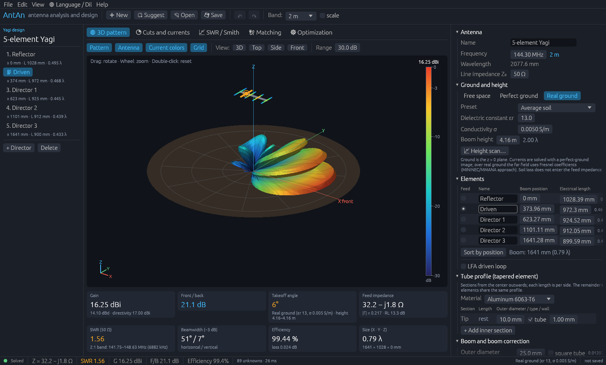

In **Ground and height**:

- **Free space** — no ground (for comparing antennas on their own).
- **Perfect ground** — an ideal conducting ground.
- **Real ground** — pick a soil from **Preset** (sea water, average soil, rocky soil …) or enter the
  dielectric constant εr and conductivity σ.
- For a Yagi set the **Boom height**. For a wire model set **Height (lowest point)**, or use
  **Shift all (z)** / **sit on ground**. When you switch a wire model from free space to ground, it is
  lifted to λ/2 (at most 10 m) automatically.
- **📈 Height scan…** solves the antenna at many heights (e.g. 0.1 … 2 λ) and plots gain and
  takeoff angle against height, with a table of F/B, impedance and SWR. Hover the chart to read
  values; click it (or *apply* in the table) to set that height on the model.

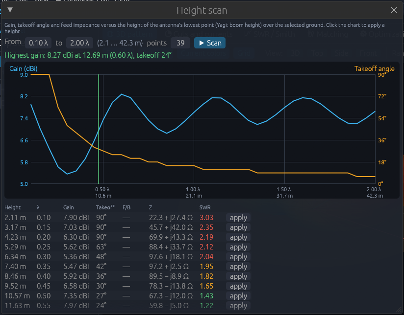

With ground, a **Takeoff angle** card appears — the elevation of maximum radiation. Higher antennas
give lower angles (better for DX). The horizontal cut is then taken at the takeoff angle.

> Over real ground AntAn uses the same approach as MININEC/MMANA: currents are solved over perfect
> ground and the far field uses the soil's reflection. Ground loss is therefore not included in the
> feed impedance — this matters mostly for verticals close to the ground.

## 9. From design to workshop: boom correction and cut list

### Boom correction

A metal boom passing through the elements makes them electrically shorter, so they must be cut a
little longer. In **Boom and boom correction**:

- Enter the boom **outer diameter** (or side, for a **square tube**), wall thickness and material.
- Choose how **parasitic elements** and the **driven element** are mounted:
  *through boom, bonded*; *through boom, insulated* (half the correction); *no correction*
  (insulating boom or elements well clear of it); or *user defined* — e.g. for elements mounted on
  insulators above the boom, for which no published formula exists.
- The correction (DL6WU/G3SEK formula) appears below and in the **Cut length** column of the element table.
- *Overhang* is the boom length beyond the end elements; *Telescoping overlap* is how far one tube
  slides into the next.

### Cut list

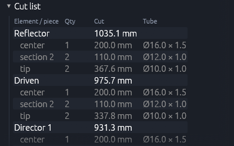

The **Cut list** section gives, for every element, each tube piece: quantity, cut length and
diameter × wall — telescoping overlap and boom correction included. Below it is the total tubing per
tube size (without waste). **📋 Copy cut list to clipboard** puts it into any text editor.

### Mechanics

**Mechanics** shows the mass of each element and the boom, the tip sag of each center-supported
element under its own weight, and the wind load at the speed you enter.

## 10. Wire models: any antenna

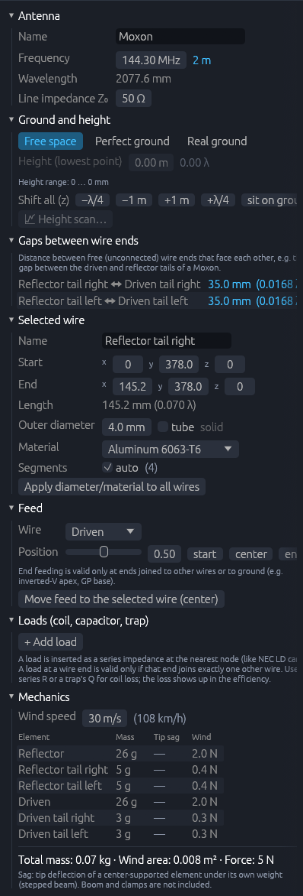

Anything that is not an element-based Yagi is a **wire model**.

1. **➕ New → Wire models** offers ready-made antennas: dipole, inverted V, folded dipole,
   coil-loaded short dipole (half size), 2-element quad, delta loop, ground plane, Moxon,
   ground-mounted vertical, trap dipole, coil-loaded vertical. **Edit → Convert to wire model** turns a Yagi into wires as well.
2. Select a wire in the model tree. In **Selected wire** set the start and end coordinates (mm),
   outer diameter, tube/solid, material and segment count (*auto* is fine almost always).
3. **Joining wires:** give two wire ends exactly the same coordinates — AntAn connects them
   automatically (corners, T-junctions, radials). No separate "connect" command is needed.
4. **+ Wire / Duplicate / Delete** under the model tree add and remove wires.
5. **Feed:** choose the wire and the position along it (0 start, 0.5 center, 1 end). Feeding at an end
   works only where that end joins another wire or the ground — e.g. the apex of an inverted V or the
   base of a vertical.

**Gaps between wire ends.** Where two free wire ends face each other — e.g. the gap between the
driven and reflector tails of a Moxon — the distance is listed in **Gaps between wire ends** and
drawn as an amber dashed dimension in the 3D view.

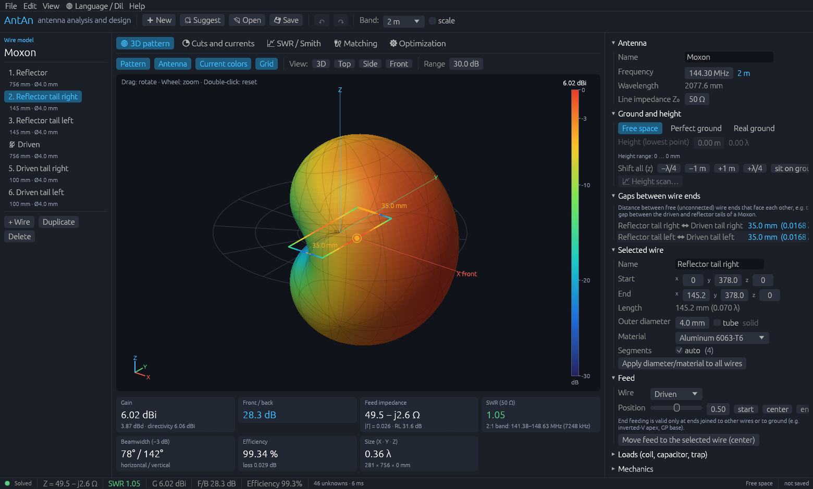

## 11. Loads: coils, capacitors and traps

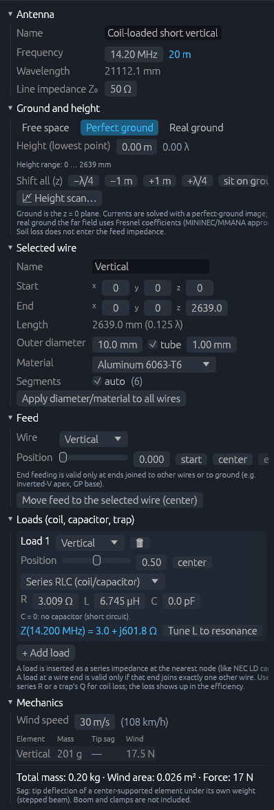

In **Loads (coil, capacitor, trap)** click **+ Add load**, then choose the wire and position and the
type:

- **Series RLC** — a coil and/or capacitor in series with the wire (C = 0 means no capacitor).
- **Parallel RLC**.
- **Trap** — a parallel LC defined by L, the resonant frequency f₀ and the coil Q.
- **Fixed R + jX** — a frequency-independent impedance.

The impedance of the load at the current frequency is shown under it. **Tune L to resonance** finds
the coil value that makes the feed reactance zero — e.g. the loading coil of a short vertical. When
the load has a symmetric twin on the same wire (as in the coil-loaded dipole) both coils are tuned
together.
Resistance (or the trap's Q) is coil loss and lowers the efficiency.

For a Yagi the section is called **Element loads**: a load at position 0 sits at the element center;
any other position puts one load on each arm, symmetrically — useful for shortened HF Yagis.

## 12. Antenna suggestions

**💡 Suggest** (toolbar, or **➕ New → Suggestions for a frequency…**) asks for a frequency or band
and builds every suitable antenna type for it — Yagis, LFA, Moxon, quad, dipoles, loops, verticals —
solves them and lists gain, front/back, feed impedance, SWR and the largest dimension side by side
(amber above 12 m, red above 25 m). **Open** loads one as a new design. Beams and wire antennas are
compared in free space; verticals with their ground.

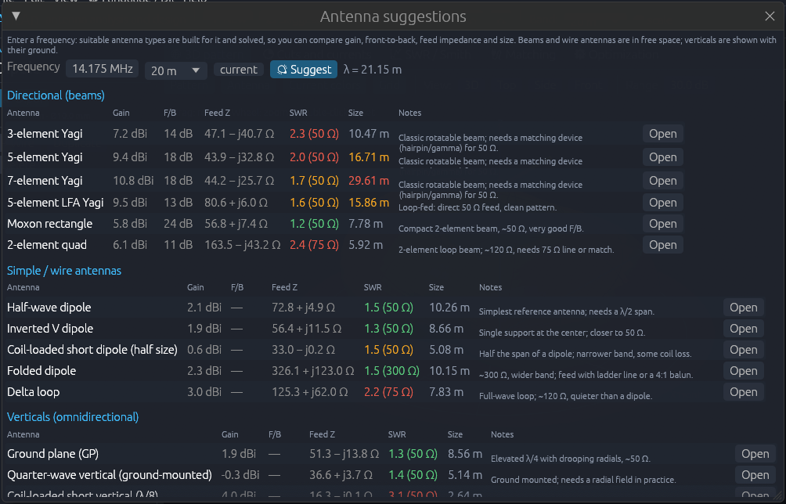

## 13. LFA Yagi (loop fed array)

In an LFA (G0KSC style) the driven element is a rectangular **loop lying in the element plane**,
about one wavelength around, fed at the middle of its rear side. It gives a direct ~50 Ω feed without
a matching device. **➕ New → LFA Yagi** creates 3 … 11 element designs whose loop size was tuned with
this solver. Any Yagi can be switched with the **LFA driven loop** checkbox under the element table:
the driven element's length is then the loop's long side and **loop width** is measured along the
boom. The cut list shows the loop sides; no boom correction is applied to the loop. The starting
directors are the standard ones — run the Optimization tab for the best front/back.

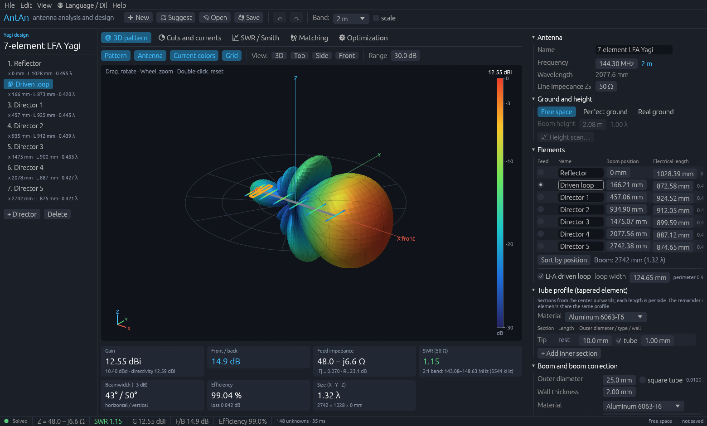

## 14. Files

- **File → Save / Save as** stores the project as a `.antan` file (readable JSON). **Open** loads it.
- **File → Export as NEC-2 file** writes a NEC card deck for comparing with 4nec2, xnec2c or EZNEC.
- **File → Save window as PNG** saves a picture of the program window.

## 15. Keyboard shortcuts

| Keys | Action |
|---|---|
| Ctrl+O | Open |
| Ctrl+S | Save |
| Ctrl+Z | Undo |
| Ctrl+Y | Redo |
| Mouse drag (3D) | Rotate |
| Mouse wheel (3D) | Zoom |
| Double-click (3D) | Reset view |

## 16. Troubleshooting

| Message or symptom | Cause and fix |
|---|---|
| "No solution" in the middle of the window | The reason is written in the status bar. The most common ones follow. |
| *Source … is not at a valid point* | The feed is at a free wire end. Move it to the center (0.5), or to an end that joins another wire or the ground. |
| *Wire … goes below ground* | With ground enabled every wire must have z ≥ 0. Raise the antenna (Shift all / Boom height). |
| *Load … is not at a valid point* | Loads must be inside a wire or where exactly two wires meet. |
| SWR is high | Use the Matching tab, or let the optimizer include SWR. |
| "Tune L to resonance" fails | Start from a smaller inductance; very large coils can resonate with the wire beyond them. |
| *The model is electrically too large at this frequency* | The frequency is far above what the geometry was made for. Lower it, or use **Scale the antenna to this frequency** under the frequency field. |
| Results differ slightly from NEC | Normal — a few percent is expected between programs. |

## 17. Accuracy and limitations

AntAn uses a thin-wire method-of-moments solver that was checked against known results: the
half-wave dipole (≈ 73 + j42 Ω, 2.15 dBi), energy conservation, image theory over ground and more —
see the [README](../README.md) for the full list.

- Differences of a few percent from NEC are normal.
- Over real ground, soil loss is not part of the feed impedance (section 8).
- The gamma match model is approximate.
- Very thick wires, very short segments and wires that come extremely close to each other reduce
  accuracy, as with any thin-wire program.
